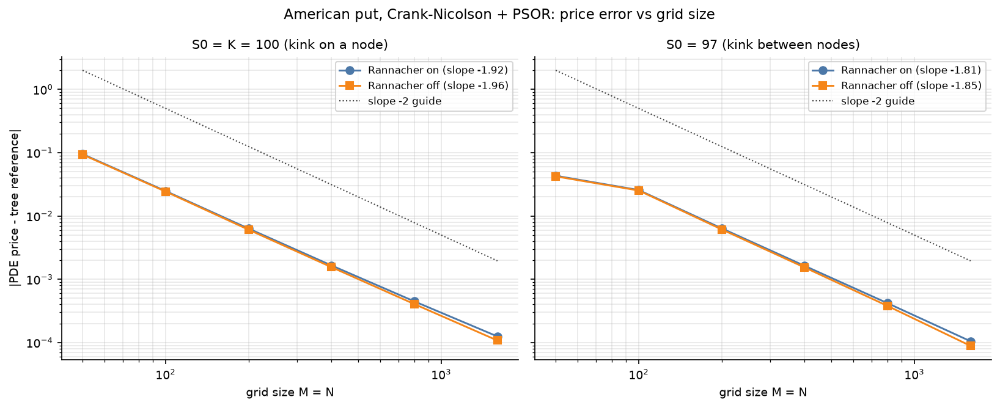
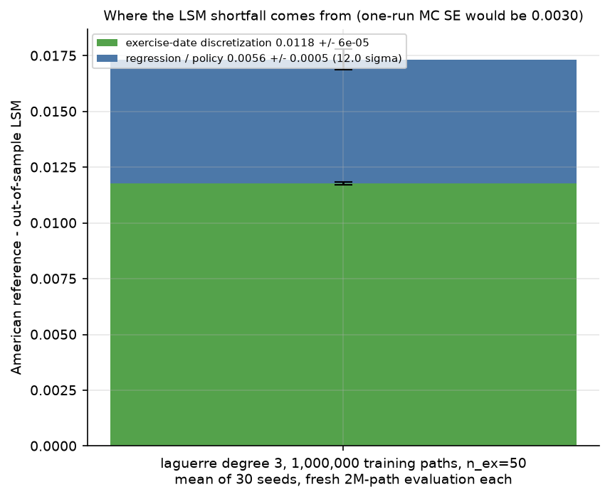
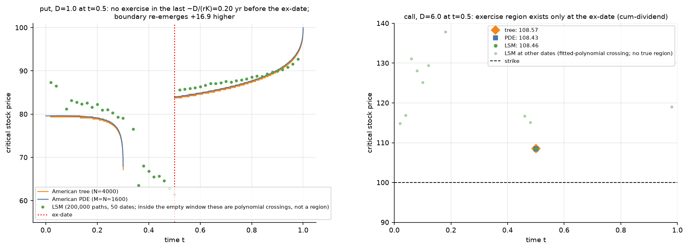
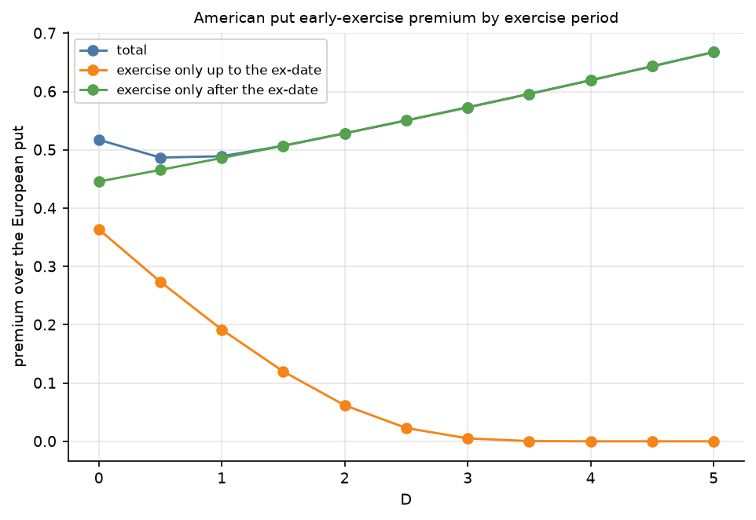

# american-option-methods

I compare three ways of pricing American options (a binomial tree, a Crank-Nicolson PDE solver and Longstaff-Schwartz Monte Carlo), first on their own and then with discrete cash dividends. I then check the resulting model against one snapshot of listed option prices (AMZN and SPY on 2025-05-15, from WRDS OptionMetrics). That last step is a sanity check on the model, not a search for mispricings, and nothing here is a trading signal.

1. The tree and PDE agree on a benchmark American put (S=K=100, T=1, r=5%, σ=20%) at 6.0904, and the PDE error shrinks at roughly second order.
2. LSM can only exercise on its simulation dates, so it really prices a Bermudan option. Against a 50-date Bermudan benchmark it comes out low by 0.0056 ± 0.0005 with a million paths. Restricting exercise to those dates costs another 0.0118.
3. With one cash dividend, the choice of dividend model (spot-jump or escrowed) moves the put price by 0.13. The gap between the PDE and the tree is about 1e-5.
4. On AMZN and SPY quotes from 2025-05-15, American and Black-Scholes implied vols differ by about 0.2 vol points at the money, as I predicted, and my American IVs match OptionMetrics' to a median of 0.01 to 0.05 vol points.
5. Two predictions failed. The AMZN parity premium sits about $0.21 above the model's, and SPY's call-put IV gap is larger under the American model (1.95 vol points) than under Black-Scholes (1.04). Both look like an input common to all strikes rather than the model, but I haven't traced the cause.

The detail is in [Steps 1-4](docs/steps_1_4.md) (methods, convergence, LSM, dividends), the [market check](docs/market_check.md) (data, cleaning, predictions, verdicts, limitations) and the [diagnostics](docs/diagnostics.md) (post-hoc analysis of the two failures).

## Validation

These are the checks I trust most. `scripts/validation.py` measures them, and each one is asserted in the test suite with a tolerance set from the measured value:

<!-- table:validation -->
| check | measured | compared with |
|---|---|---|
| r = 0 put is never exercised early: tree N=500: American - European | 3.55e-15 | 0 |
| r = 0 put is never exercised early: PDE M=400, N=200: American - European | -3.65e-10 | 0 |
| Merton: call, D = 0.8 x threshold: tree N=4000: American - European | 0 | 0 (empty exercise region) |
| Merton: call, D = 3 x threshold: tree N=4000: American - European (premium) | 1.0039 | > 0 |
| put exercise region is empty before the ex-date: window length t_d - t_vanish, D=1 (tree N=4000) | 0.1990 | D/(rK) = 0.2000 |
| perpetual put boundary (T=30, r=8%, σ=40%): max over t = 1.5, 3.0, 6.0 of \|S*(t) - 50.0\| / 50.0, tree N=3000 | 0.0265 | relative node spacing 0.080 |
<!-- /table:validation -->

The LSM tests compare against Black-Scholes where early exercise has no value (a call with q = 0, a put with r = 0); their z-scores are printed by `pytest -rP tests/test_lsm.py`. The pipeline tests recover a known synthetic vol surface against a finer-grid truth, and the cleaner rejects each injected bad-quote type with the right reason code. All tests use synthetic data, with no network access or vendor data.

## Figures



PDE price error against the tree reference, falling at roughly second order in M=N (S=K=100, T=1, r=5%, σ=20%, put).



Bias decomposition of the Bermudan LSM price at a million paths: exercise-date discretization and regression error, with error bars.



Exercise boundaries with a cash dividend (put with D=1, call with D=6), showing the empty exercise window before the ex-date and the jump across it.



Put early-exercise premium against dividend size, split by whether exercise happens before or after the ex-date; the two parts move in opposite directions.

## Market check

I wrote five predictions before running the comparison. Three held: the gap between Black-Scholes and American put IVs is small near the money, AMZN calls agree under both models, and my IVs sit close to the vendor's. Two failed, as in finding 5. At the grid I had set (M=N=400), the largest SPY IV change from M=N=400 to 1600 is 0.0902 vol points, 2.75 times the median bid-ask half-width of 0.0328, and 6.9% of SPY contracts change by more than their own half-width. That fails my discretization requirement, although no prediction changes verdict when I recompute on the finer grids. The verdict table, the cleaning rules and the sensitivity of the gaps to the inputs are in [docs/market_check.md](docs/market_check.md).

Everything after that is post-hoc and lives in [docs/diagnostics.md](docs/diagnostics.md). A parity regression on American puts is biased by early exercise. Once I correct for that, a roughly constant dollar offset between the quotes and the model remains for both underlyings, and I haven't traced it. In the deep in-the-money SPY wing, the call-put IV failure is mostly low vega acting on a dollar gap that sits inside the quoted spreads. The market figures, which plot per-contract implied vols, are in the docs only.

## Limitations

- One snapshot, two underlyings and end-of-day quotes, taken about five weeks after the April 2025 selloff, so volatility was probably elevated. I haven't run a replication on another date.
- The parity offset and the SPY call-put gap are not traced to a cause (spot, timing, rate or borrow).
- The inputs are uncertain by as much as the effects I read, so I don't attribute any gap to the model alone, and I don't call any of them a mispricing.
- I wrote my predictions in docs/hypotheses_step5.md before running the analysis, but the committed copy was made after the results, so I can't prove the timing.
- Test tolerances were set from measurements, and the standard errors treat neighbouring strikes as independent, so they are too narrow.
- WRDS data is licensed, so it isn't in the repository (`data/` is ignored).

## Reproduction

```bash
python3 -m venv .venv && .venv/bin/pip install -r requirements.txt && .venv/bin/pip install -e . --no-deps   # Python 3.13.3 used; 3.11 or later required
make test            # pytest, synthetic data only
make steps-1-4       # Steps 1-4 figures and tables
make step5-synthetic # market pipeline on the synthetic fixture
make step5 step6     # needs data/raw/ from WRDS
make validation readme-tables audit
```

Runtimes and the WRDS pull instructions are in [CONTRIBUTING.md](CONTRIBUTING.md).