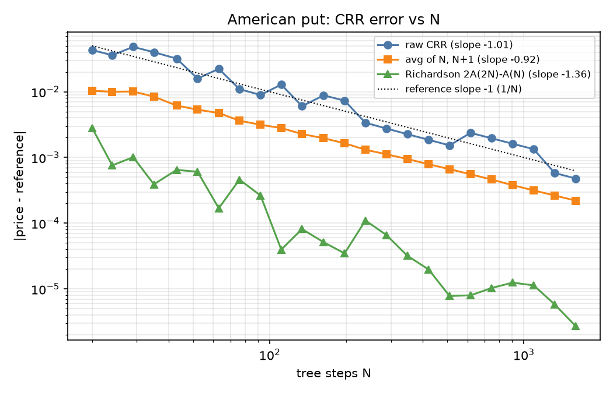
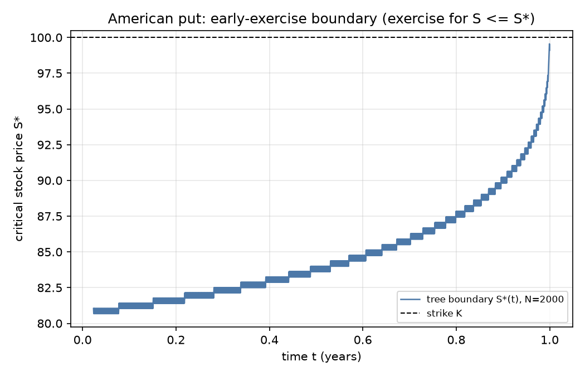
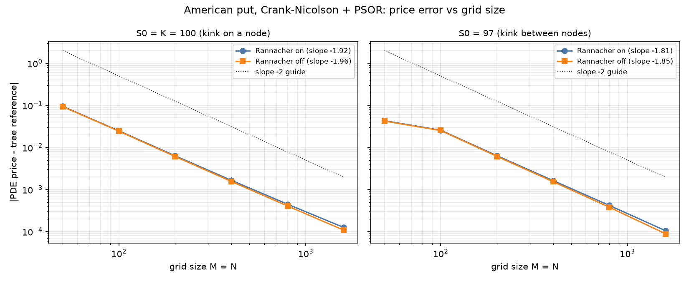
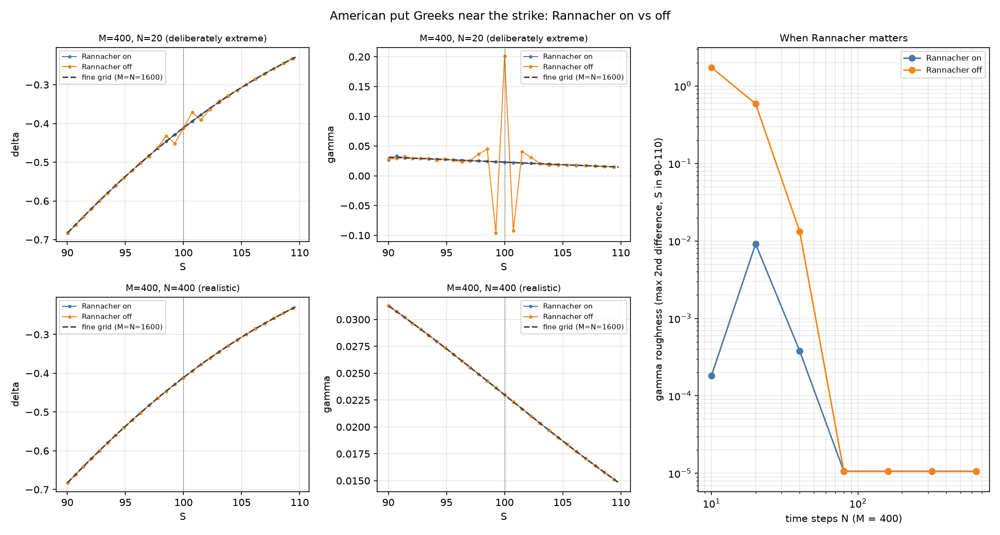
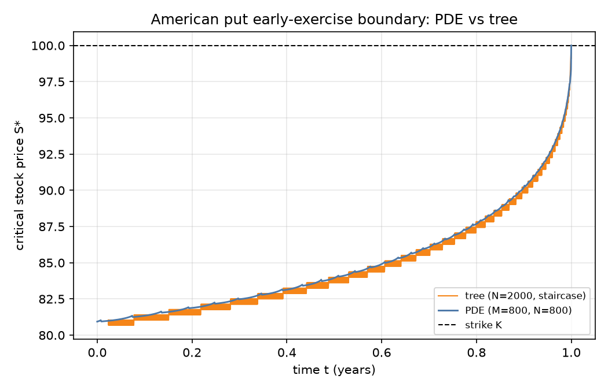
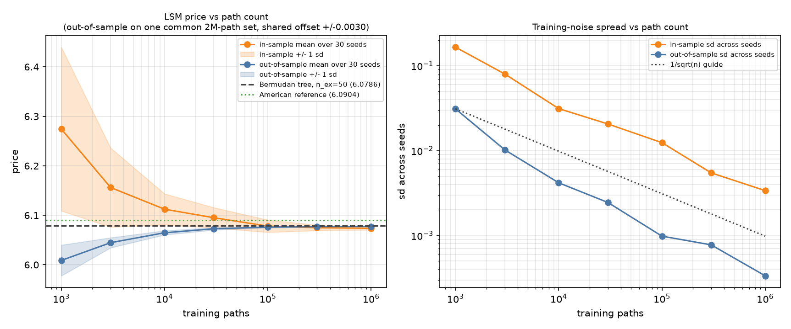
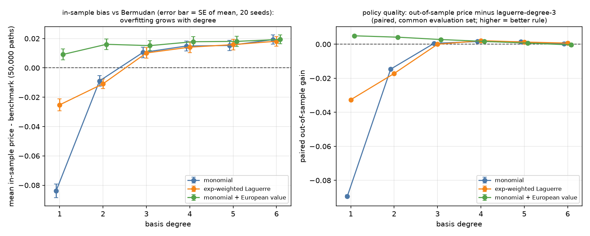
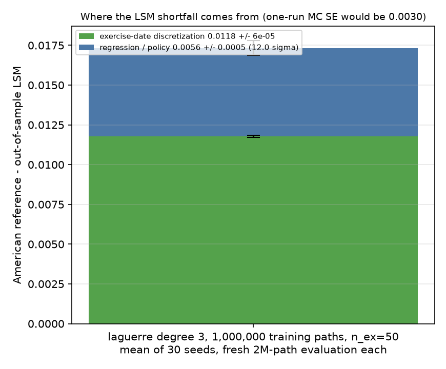
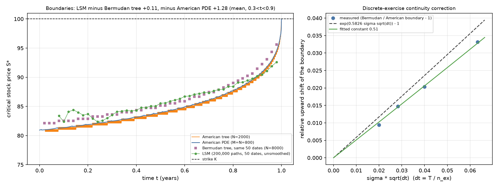

# american-option-methods

Comparison of binomial-tree, Crank-Nicolson PDE and Longstaff-Schwartz Monte Carlo pricers
for American options (continuous dividend yield `q`). Rigor and reproducibility over speed.

**Status: Steps 1-3 complete** (CRR tree and Bermudan benchmark, Black-Scholes, reference price; Crank-Nicolson PDE
with PSOR/penalty; Longstaff-Schwartz Monte Carlo). Discrete dividends and real-data checks are not implemented.

## Setup

```bash
python3 -m venv .venv && .venv/bin/pip install -e ".[dev]"
.venv/bin/pytest
.venv/bin/python scripts/step1_convergence.py   # writes results/figures/step1_*.png
.venv/bin/python scripts/step2_pde.py           # figures + results/tables/step2_table.csv, pde_domain_sensitivity.csv
.venv/bin/python scripts/step3_lsm.py           # ~5 minutes; figures + results/tables/*.csv
.venv/bin/pytest -rP tests/test_lsm.py          # also prints the observed z-scores
```

## Layout

| File | Purpose |
|---|---|
| `src/aopt/params.py` | frozen, validated `OptionParams(S, K, T, r, q, sigma, option_type)` |
| `src/aopt/bs.py` | vectorized Black-Scholes price and delta with yield `q` |
| `src/aopt/tree.py` | CRR tree (O(N) memory), `exercise_boundary` |
| `src/aopt/reference.py` | averaged + Richardson-extrapolated reference price with error estimate |
| `src/aopt/pde.py` | Crank-Nicolson solver (log-price grid), PSOR and penalty American handling, Rannacher startup, event hooks |
| `src/aopt/lsm.py` | Longstaff-Schwartz MC: three basis families, in-/out-of-sample estimators, boundary extraction |
| `src/aopt/timing.py` | `median_runtime` helper |
| `src/aopt/interface.py` | `price(params, method, **kwargs)` dispatcher |

## Methodology notes

- **Tree:** CRR, `u = exp(sigma*sqrt(dt))`, `p = (exp((r-q)dt) - d)/(u - d)`; raises `ValueError` if `p` is outside [0, 1].
- **Boundary:** at each step, S*(t) is the extreme node where exercise strictly beats continuation
  (puts: largest S; calls: smallest S); NaN if no node qualifies. It is a step function with
  resolution ~ `S*sigma*sqrt(dt)`, so tests use node-spacing tolerances.
- **Reference price:** `A(N) = (V_N + V_{N+1})/2` damps CRR oscillation; `R(N) = 2A(2N) - A(N)`
  removes the leading 1/N term. Reported price is `R` from `A(4N), A(2N)`; the error estimate is
  the gap between the two successive Richardson values (empirical, not a bound).
- **Perpetual put check (q = 0):** try `V = A*S^(-b)` in `0.5*sigma^2*S^2*V'' + r*S*V' - r*V = 0`;
  this requires `0.5*sigma^2*b*(b+1) - r*b - r = 0`, so `b = 2r/sigma^2` is the decaying root.
  Value matching and smooth pasting (`V = K - S*`, `V' = -1` at `S*`) give `S* = K*b/(b+1)`.
  Example: r = 8%, sigma = 40% gives b = 1 and S* = 50, which the tree test checks; r = 5%, sigma = 20% gives b = 2.5, S* = 71.4.

## Step 1 results (S=K=100, T=1, r=5%, q=0, sigma=20%, put)

- Reference American put: **6.090371 +/- 1.9e-6** (literature: ~6.0904).
- Measured log-log convergence slope vs N (N = 20..1600): raw CRR **-1.01**, averaged **-0.92**,
  Richardson **-1.36**. Raw CRR is first order and oscillates; averaging removes the oscillation
  (about 2-3x smaller error at equal N, in the plot). Richardson is 1-2 orders of magnitude more accurate
  but irregular, and -1.36 is not a clean second-order rate: the early-exercise kink and the position of the
  strike relative to the final-layer nodes degrade the extrapolation, so no second-order claim is made.
- The reference is built from the tree, so tree-vs-reference errors are partly self-referential; Step 2's
  PDE is the first independent check (see below).
- European tree error vs Black-Scholes: ~1.94/N.




## Step 2: Crank-Nicolson PDE (S=K=100, T=1, r=5%, q=0, sigma=20%, put; M = N)

Design: log-price grid on `[ln K - L, ln K + L]` with `L = max(5*sigma*sqrt(T) + |r-q|*T, 1.5)` (widened by `|ln(S0/K)|`),
shifted by at most half a cell so S0 is exactly a node (no interpolation); Dirichlet boundaries
`max(European asymptote, intrinsic)`. American exercise per time step by red-black PSOR (vectorized, auto-optimal omega)
or a penalty method (semi-smooth Newton, `rho = 1e8`). Rannacher: first two CN steps replaced by four implicit
half-steps. `solve_pde(..., events=[Event(t, hook)])` forces event times to be step boundaries (unused so far).
The boundary S*(t) is sub-node accurate: the contact edge node is refined by extrapolating `sqrt(V - payoff)`, which is
locally linear because smooth pasting (V = payoff and V' = payoff' at S*) makes V - payoff vanish quadratically there.

**Domain.** The first version used `L = max(3, ...)`; for these parameters the 5-sigma rule gives only 1.05, so the grid was
~3x wider than needed. The default is now a 1.5 floor (so L = 1.5 here). Both are kept in
`results/tables/pde_domain_sensitivity.csv`:

| M = N | gap to tree reference, old L = 3 | gap, current default (L = 1.5) |
|---|---|---|
| 400 | -6.14e-3 | **-1.65e-3** |
| 800 | -1.57e-3 | -4.5e-4 |
| 1600 | -4.08e-4 | **-1.25e-4** |

Price-error slopes (M = N = 50..1600): -1.92 (Rannacher on) / -1.96 (off) at S0 = K; -1.81 / -1.85 at S0 = 97 (kink between
nodes); the old domain gave -1.99. The error is spatial and approximately second order, with a lower measured order than 2.

- **Independent check of the tree reference.** The PDE shares no code or discretization with the tree. From the unrounded
  PDE prices at M = N = 400, 800, 1600 (6.0887179, 6.0899239, 6.0902458) the observed order is 1.91 and Richardson
  extrapolation gives 6.090363 (6.090348 assuming exactly order 2 from the 400 and 1600 prices alone), which is 7.9e-6 and
  2.3e-5 from the tree reference 6.090371. This is an agreement check, not a proof: the extrapolation error is larger than
  the tree's own estimated error (1.9e-6) and is not quantified from three points.
- **Rannacher and price order.** Rannacher does not change price convergence (the price at one point barely sees the
  high-frequency error the kink injects); with Rannacher on the price error is in fact very slightly *larger* (slope -1.92
  vs -1.96; error 1.65e-3 vs 1.55e-3 at M = N = 400), which is within what the extra implicit half-steps cost. It matters
  for the Greeks, but only when the time grid is coarse relative to the space grid. At M = 400
  (`results/tables/rannacher_gamma_roughness.csv`, right panel of the Greeks figure) the unsmoothed gamma roughness is 1.7 at
  N = 10, 0.59 at N = 20 (gamma spikes to ~0.2 at the strike; true value ~0.023) and 1.3e-2 at N = 40, against 1.8e-4,
  9.1e-3 and 3.8e-4 with Rannacher. From N = 80 upward the two are identical (1.06e-5, the curve's true curvature), so at the
  realistic setting N = M = 400 Rannacher changes nothing visible. The N = 20 panel is a deliberately extreme demonstration of
  the failure mode, not typical behaviour; the rule of thumb here is that it matters when N is below roughly M/10
  (sigma^2 dt / h^2 above ~10). The wider L = 3 grid had hidden most of this.
- PSOR and penalty agree to ~1e-8 in price. Penalty is ~4-5x faster (M = N = 1600: 0.11 s vs 0.55 s) and needs ~1.06
  Newton iterations per step; PSOR needs 9-15 sweeps per step at L = 1.5, growing with M. Timings are machine dependent
  (`results/tables/step2_table.csv`).
- Boundary: matches the tree within 0.71 on 0.1 < t < 0.9 (the tree's node spacing is 0.8-1.2), has no plateaus, and is
  monotone only up to O(h) jumps where the contact edge advances one node (largest measured drop 0.20). Against a
  M = N = 3200 PDE boundary it is ~30-40% closer than the raw contact-edge node and halves per doubling of M (first order).
- **Test tolerances were set from measurements**, not derived a priori; each has its measured value and reason in the test
  comment (for example 2.5e-3 for the M = N = 400 tree agreement against a measured 1.65e-3; the originally requested 1e-3
  is met at M = N = 800).





## Step 3: Bermudan benchmark and Longstaff-Schwartz

LSM prices a **Bermudan** option on `n_ex` equally spaced dates `T/n_ex, ..., T` (t = 0 excluded), so its right target is the
Bermudan tree benchmark `tree_price(..., exercise_steps=bermudan_steps(N, n_ex))`, not the American price. The benchmark
`bermudan_reference` averages adjacent multiples of `n_ex` (N and N+1 are not both allowed) and Richardson-extrapolates with
the actual effective sizes; its error estimates (1e-5 to 5e-4) are empirical and agree with the spread across `n_base`.

Bermudan benchmark vs n_ex (American reference 6.090371):

| n_ex | 2 | 5 | 10 | 25 | 50 | 100 |
|---|---|---|---|---|---|---|
| price | 5.8388 | 5.9812 | 6.0337 | 6.0672 | 6.0786 | 6.0845 |
| American - Bermudan | 0.2516 | 0.1092 | 0.0567 | 0.0232 | 0.0118 | 0.0059 |

The shortfall halves as n_ex doubles: first order in the date spacing.

**LSM design.** Exact GBM, `default_rng(seed)` for training and `default_rng([seed, 1])` for evaluation (independent streams;
`eval_seed` selects one common evaluation set instead), optional antithetic pairs (standard errors are computed on pair
means). Regression on in-the-money paths only, `lstsq` on S/K inputs (not the normal equations); dates with too few ITM paths
are skipped and their coefficients are NaN, so the policy never exercises there. Regressors: monomial, Chebyshev (the same
polynomial span as monomial, so the same estimator, only conditioned differently; checked in a test), exponentially weighted
Laguerre (polynomial times `exp(-x/2)`, a different span but really a re-weighted polynomial, not a distinct method), and an
optional extra column holding the European option value at the remaining time (`european_basis=True`). Training memory is
`8 * n_paths * (n_ex + degree + 11)` bytes and capped at 2 GB (3.9 million training paths at n_ex = 50, degree 3; see
`max_train_paths`); out-of-sample evaluation is chunked and needs only O(chunk size) memory.

**Two ways to evaluate a fitted policy, and why the difference matters.** A *fresh* evaluation set per fit gives an unbiased
level but its noise enters every comparison. A *common* evaluation set shared by all fits cancels that noise in differences
between policies (so the spread across seeds is pure training noise), but shifts every out-of-sample level by one shared
offset of the size of that set's standard error. The two are not interchangeable: at 1,000,000 training paths the common
2M-path set gives 6.0775 while fresh sets give 6.0730, a +0.0045 shared offset (1.5 standard errors of 0.0030). Levels and
biases below therefore come from fresh evaluation sets; policy comparisons and spreads from the common set.

Results (S=K=100, n_ex = 50, Bermudan benchmark 6.0786, laguerre degree 3), 30 seeds, out-of-sample on one common
2,000,000-path antithetic set:

| training paths | in-sample mean (sd) | out-of-sample mean (sd across seeds) |
|---|---|---|
| 1,000 | 6.274 (0.166) | 6.009 (0.031) |
| 10,000 | 6.112 (0.031) | 6.065 (0.0042) |
| 100,000 | 6.078 (0.012) | 6.076 (0.0010) |
| 1,000,000 | 6.074 (0.003) | 6.0775 (0.0003) |

- The out-of-sample spread now keeps falling (0.031 at 1,000 paths to 0.0003 at 1,000,000, roughly 1/sqrt(n) from 1e5 up and
  faster below, where policy error is also converging). The earlier plateau near 0.009 was the 200,000-path evaluation noise,
  not the training. The out-of-sample *levels* in this table carry the shared +/-0.0030 offset described above.
- In-sample is biased **high** at small samples (overfitting: +0.196 at 1,000 paths) and, at large samples, slightly
  **low** (-0.0048 +/- 0.0006 at 1,000,000 paths): the policy is the limit there, not noise.
- **Bias decomposition** (laguerre degree 3, 1,000,000 training paths, mean over 30 seeds, each evaluated on a fresh
  2,000,000-path set; each component has its own error bar):

  | component | value |
  |---|---|
  | exercise-date discretization (American reference - Bermudan benchmark) | 0.01177 +/- 0.00006 (reference error estimates) |
  | regression/policy (Bermudan benchmark - mean out-of-sample LSM) | **0.00557 +/- 0.00046** (12 sigma) |
  | total (American reference - mean out-of-sample LSM) | 0.01734 +/- 0.00047 |

  The one-run standard error is 0.0030. An earlier version of this decomposition (100,000 paths, one 200,000-path evaluation
  per seed) showed 0.0047 against a one-run standard error of 0.0095, which could not be told from zero; the policy term is
  real but needs the seed mean and the larger evaluation set to resolve.
- **Basis and degree** (50,000 training paths, 20 seeds; `results/tables/lsm_basis_sweep.csv`). *Overfitting:* in-sample bias
  rises with degree, from -0.084 (degree 1) through +0.011 (3) to +0.019 (6) for monomials, because the exercise rule is fitted
  to the paths it is paid on. *Policy quality* (paired out-of-sample gain relative to laguerre degree 3, common evaluation
  set): degrees 1-2 are clearly worse (monomial -0.089 / -0.015), degrees 3-6 differ by at most ~0.002 (monomial degree 4:
  +0.0016 +/- 0.0004), i.e. a plateau from degree 3. Weighting by `exp(-x/2)` helps only at degree 1 (-0.033 vs -0.089).
- **European value as an extra regressor** is the one genuinely different basis function tried. It lifts low degrees:
  degree 1 plus the European value gains **+0.0050 +/- 0.0005** over laguerre degree 3 with three coefficients instead of four,
  and degree 2 gains +0.0042, beating every plain polynomial up to degree 6 (best +0.002); the benefit disappears from
  degree 4 up (+0.0017) and is gone at 6. At 50,000 paths the plain degree-3 policy shortfall is about 0.011 (fresh-evaluation bias -0.0113, but with a standard
  error of the mean near 0.004), so the +0.005 gain is very roughly 40% of it; the gain itself is precise (paired, +/-0.0005),
  the denominator is not.
- **Boundary.** The previous comparison set a 50-date Bermudan policy against an *American* boundary. With the Bermudan tree
  boundary on the same 50 dates added, the mean gap over 0.3 < t < 0.9 drops from **+1.28** (vs American PDE) to **+0.11**
  (vs Bermudan tree; mean absolute 0.38), so most of the "LSM error" was the exercise-date effect, not LSM. The shift matches
  the continuity-correction form exp(beta sigma sqrt(dt)) (Broadie-Glasserman-Kou), but the measured constant is not 0.5826:
  the Bermudan/American boundary ratio is 1.0332, 1.0203, 1.0147, 1.0094 for n_ex = 10, 25, 50, 100, against 1.0375, 1.0236,
  1.0166, 1.0117 predicted with 0.5826, i.e. 80-89% of the predicted shift and an implied constant of 0.47-0.52 (0.51 fitted
  through the origin; `results/tables/boundary_shift.csv`). At n_ex = 50 that is +1.25 on a boundary near 85 against the
  +1.41 predicted. I did not investigate why the constant is smaller (the tree boundary itself has node-level noise of ~0.4
  and the PDE reference boundary ~0.1%). The LSM boundary stays noisy (unsmoothed, wild at the earliest dates where no paths
  sit far below S0) and only the trend is tested.
- **Test z-scores** (fixed seeds, 100,000 training paths; criterion |z| < 4): call q = 0 vs Black-Scholes +0.74 in-sample /
  -2.09 out-of-sample; put r = 0 vs Black-Scholes -1.76 / **-3.13**; put vs Bermudan benchmark -2.20 / -1.18; deep ITM put
  +0.38; antithetic reduces the standard error by ~39% (ratio 0.61) in both modes. Where early exercise has no value
  (call q = 0, put r = 0) the true policy never exercises, so any fitted rule can only lose value: the out-of-sample tests are
  therefore one-sided (at most European + 4 SE) with a stated magnitude bound on the shortfall (measured 0.048 and 0.035,
  bounds 0.10 and 0.07), while in-sample stays two-sided.






Raw data for the Step 4 error-vs-runtime plot is in `results/tables/pareto_raw.csv` (tree, extrapolated tree, PDE PSOR and
penalty, LSM in- and out-of-sample over 5 seeds, laguerre degree 3). LSM errors there are against the *American* reference,
so they include the 0.0118 discretization term.