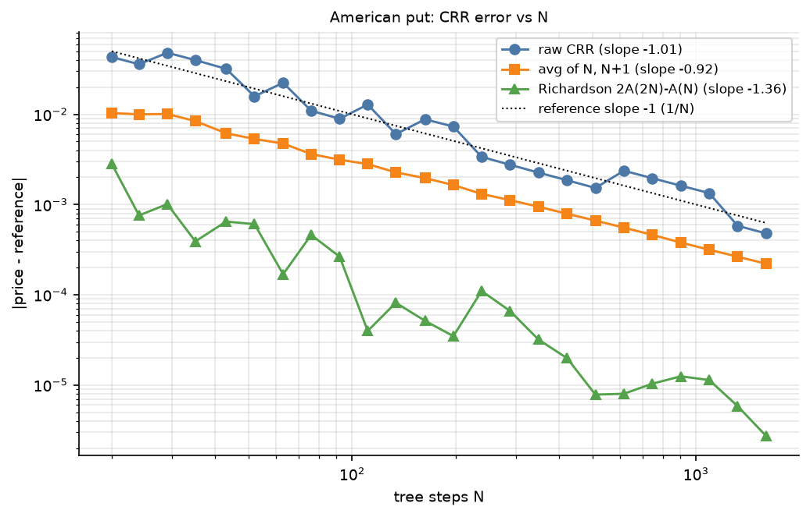
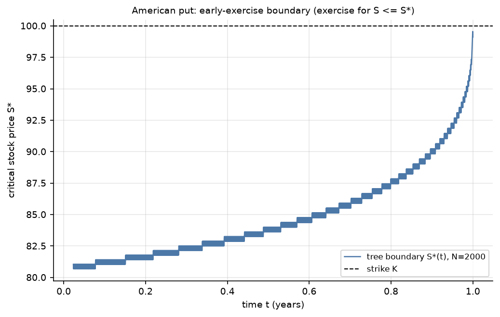
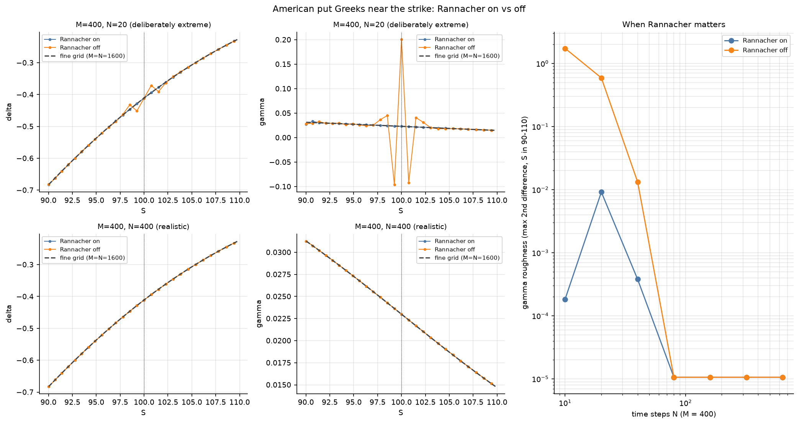
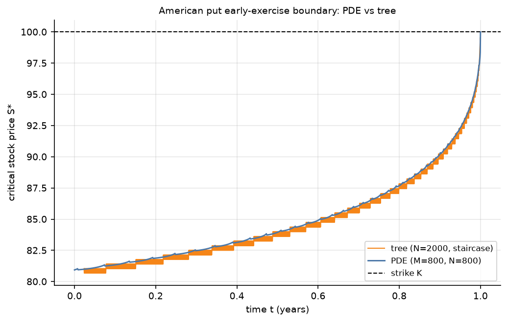
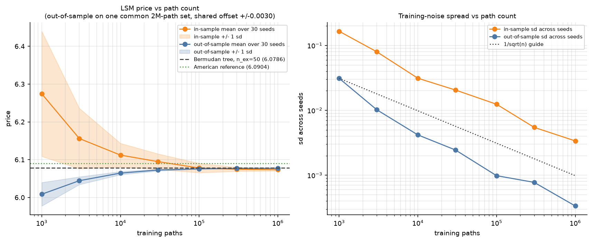
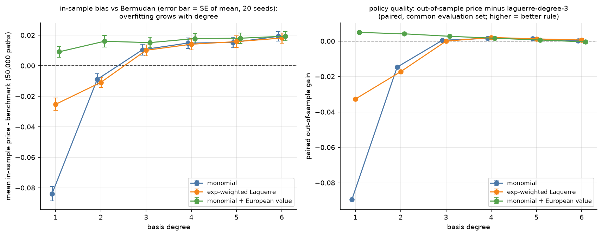
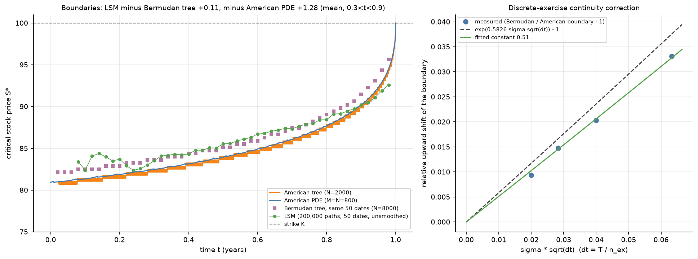

# american-option-methods

Comparison of binomial-tree, Crank-Nicolson PDE and Longstaff-Schwartz Monte Carlo pricers
for American options (continuous dividend yield `q`). Rigor and reproducibility over speed.

**Status: Steps 1-3 complete** (CRR tree and Bermudan benchmark, Black-Scholes, reference price; Crank-Nicolson PDE
with PSOR/penalty; Longstaff-Schwartz Monte Carlo). Discrete dividends and real-data checks are not implemented.

## Setup

```bash
python3 -m venv .venv && .venv/bin/pip install -e ".[dev]"
.venv/bin/pytest
.venv/bin/python scripts/step1_convergence.py   # writes results/figures/step1_*.png
.venv/bin/python scripts/step2_pde.py           # figures + results/tables/step2_table.csv, pde_domain_sensitivity.csv
.venv/bin/python scripts/step3_lsm.py           # ~5 minutes; figures + results/tables/*.csv
.venv/bin/pytest -rP tests/test_lsm.py          # also prints the observed z-scores
```

## Layout

| File | Purpose |
|---|---|
| `src/aopt/params.py` | frozen, validated `OptionParams(S, K, T, r, q, sigma, option_type)` |
| `src/aopt/bs.py` | vectorized Black-Scholes price and delta with yield `q` |
| `src/aopt/tree.py` | CRR tree (O(N) memory), `exercise_boundary` |
| `src/aopt/reference.py` | averaged + Richardson-extrapolated reference price with error estimate |
| `src/aopt/pde.py` | Crank-Nicolson solver (log-price grid), PSOR and penalty American handling, Rannacher startup, event hooks |
| `src/aopt/lsm.py` | Longstaff-Schwartz MC: three basis families, in-/out-of-sample estimators, boundary extraction |
| `src/aopt/timing.py` | `median_runtime` helper |
| `src/aopt/interface.py` | `price(params, method, **kwargs)` dispatcher |

## Methodology notes

- **Tree:** CRR, `u = exp(sigma*sqrt(dt))`, `p = (exp((r-q)dt) - d)/(u - d)`; raises `ValueError` if `p` is outside [0, 1].
- **Boundary:** at each step, S*(t) is the extreme node where exercise strictly beats continuation
  (puts: largest S; calls: smallest S); NaN if no node qualifies. It is a step function with
  resolution ~ `S*sigma*sqrt(dt)`, so tests use node-spacing tolerances.
- **Reference price:** `A(N) = (V_N + V_{N+1})/2` damps CRR oscillation; `R(N) = 2A(2N) - A(N)`
  removes the leading 1/N term. Reported price is `R` from `A(4N), A(2N)`; the error estimate is
  the gap between the two successive Richardson values (empirical, not a bound).
- **Perpetual put check (q = 0):** try `V = A*S^(-b)` in `0.5*sigma^2*S^2*V'' + r*S*V' - r*V = 0`;
  this requires `0.5*sigma^2*b*(b+1) - r*b - r = 0`, so `b = 2r/sigma^2` is the decaying root.
  Value matching and smooth pasting (`V = K - S*`, `V' = -1` at `S*`) give `S* = K*b/(b+1)`.
  Example: r = 8%, sigma = 40% gives b = 1 and S* = 50, which the tree test checks; r = 5%, sigma = 20% gives b = 2.5, S* = 71.4.

## Step 1 results (S=K=100, T=1, r=5%, q=0, sigma=20%, put)

- Reference American put: **6.090371 +/- 1.9e-6** (literature: ~6.0904).
- Measured log-log convergence slope vs N (N = 20..1600): raw CRR **-1.01**, averaged **-0.92**,
  Richardson **-1.36**. Raw CRR is first order and oscillates; averaging removes the oscillation
  (about 2-3x smaller error at equal N, in the plot). Richardson is 1-2 orders of magnitude more accurate
  but irregular, and -1.36 is not a clean second-order rate: the early-exercise kink and the position of the
  strike relative to the final-layer nodes degrade the extrapolation, so no second-order claim is made.
- The reference is built from the tree, so tree-vs-reference errors are partly self-referential; Step 2's
  PDE is the first independent check (see below).
- European tree error vs Black-Scholes: ~1.94/N.




## Step 2: Crank-Nicolson PDE (S=K=100, T=1, r=5%, q=0, sigma=20%, put; M = N)

Design: log-price grid on `[ln K - L, ln K + L]` with `L = max(5*sigma*sqrt(T) + |r-q|*T, 1.5)` (widened by `|ln(S0/K)|`),
shifted by at most half a cell so S0 is exactly a node (no interpolation); Dirichlet boundaries
`max(European asymptote, intrinsic)`. American exercise per time step by red-black PSOR (vectorized, auto-optimal omega)
or a penalty method (semi-smooth Newton, `rho = 1e8`). Rannacher: first two CN steps replaced by four implicit
half-steps. `solve_pde(..., events=[Event(t, hook)])` forces event times to be step boundaries (unused so far).
The boundary S*(t) is sub-node accurate: the contact edge node is refined by extrapolating `sqrt(V - payoff)`, which is
locally linear because smooth pasting (V = payoff and V' = payoff' at S*) makes V - payoff vanish quadratically there.

**Domain.** The first version used `L = max(3, ...)`; for these parameters the 5-sigma rule gives only 1.05, so the grid was
~3x wider than needed. The default is now a 1.5 floor (so L = 1.5 here). Both are kept in
`results/tables/pde_domain_sensitivity.csv`:

| M = N | gap to tree reference, old L = 3 | gap, current default (L = 1.5) |
|---|---|---|
| 400 | -6.14e-3 | **-1.65e-3** |
| 800 | -1.57e-3 | -4.5e-4 |
| 1600 | -4.08e-4 | **-1.25e-4** |

Price-error slopes (M = N = 50..1600): -1.92 (Rannacher on) / -1.96 (off) at S0 = K; -1.81 / -1.85 at S0 = 97 (kink between
nodes); the old domain gave -1.99. The error is spatial and approximately second order, with a lower measured order than 2.

- **Independent check of the tree reference.** The PDE shares no code or discretization with the tree. From the unrounded
  PDE prices at M = N = 400, 800, 1600 (6.0887179, 6.0899239, 6.0902458) the observed order is 1.91 and Richardson
  extrapolation gives 6.090363 (6.090348 assuming exactly order 2 from the 400 and 1600 prices alone), which is 7.9e-6 and
  2.3e-5 from the tree reference 6.090371. This is an agreement check, not a proof: the extrapolation error is larger than
  the tree's own estimated error (1.9e-6) and is not quantified from three points.
- **Rannacher and price order.** Rannacher does not change price convergence (the price at one point barely sees the
  high-frequency error the kink injects); with Rannacher on the price error is in fact very slightly *larger* (slope -1.92
  vs -1.96; error 1.65e-3 vs 1.55e-3 at M = N = 400), which is within what the extra implicit half-steps cost. It matters
  for the Greeks, but only when the time grid is coarse relative to the space grid. At M = 400
  (`results/tables/rannacher_gamma_roughness.csv`, right panel of the Greeks figure) the unsmoothed gamma roughness is 1.7 at
  N = 10, 0.59 at N = 20 (gamma spikes to ~0.2 at the strike; true value ~0.023) and 1.3e-2 at N = 40, against 1.8e-4,
  9.1e-3 and 3.8e-4 with Rannacher. From N = 80 upward the two are identical (1.06e-5, the curve's true curvature), so at the
  realistic setting N = M = 400 Rannacher changes nothing visible. The N = 20 panel is a deliberately extreme demonstration of
  the failure mode, not typical behaviour; the rule of thumb here is that it matters when N is below roughly M/10
  (sigma^2 dt / h^2 above ~10). The wider L = 3 grid had hidden most of this.
- PSOR and penalty agree to ~1e-8 in price. Penalty is ~4-5x faster (M = N = 1600: 0.11 s vs 0.55 s) and needs ~1.06
  Newton iterations per step; PSOR needs 9-15 sweeps per step at L = 1.5, growing with M. Timings are machine dependent
  (`results/tables/step2_table.csv`).
- Boundary: matches the tree within 0.71 on 0.1 < t < 0.9 (the tree's node spacing is 0.8-1.2), has no plateaus, and is
  monotone only up to O(h) jumps where the contact edge advances one node (largest measured drop 0.20). Against a
  M = N = 3200 PDE boundary it is ~30-40% closer than the raw contact-edge node and halves per doubling of M (first order).
- **Test tolerances were set from measurements**, not derived a priori; each has its measured value and reason in the test
  comment (for example 2.5e-3 for the M = N = 400 tree agreement against a measured 1.65e-3; the originally requested 1e-3
  is met at M = N = 800).





## Step 3: Bermudan benchmark and Longstaff-Schwartz

LSM prices a **Bermudan** option on `n_ex` equally spaced dates `T/n_ex, ..., T` (t = 0 excluded), so its right target is the
Bermudan tree benchmark `tree_price(..., exercise_steps=bermudan_steps(N, n_ex))`, not the American price. The benchmark
`bermudan_reference` averages adjacent multiples of `n_ex` (N and N+1 are not both allowed) and Richardson-extrapolates with
the actual effective sizes; its error estimates (1e-5 to 5e-4) are empirical and agree with the spread across `n_base`.

Bermudan benchmark vs n_ex (American reference 6.090371):

| n_ex | 2 | 5 | 10 | 25 | 50 | 100 |
|---|---|---|---|---|---|---|
| price | 5.8388 | 5.9812 | 6.0337 | 6.0672 | 6.0786 | 6.0845 |
| American - Bermudan | 0.2516 | 0.1092 | 0.0567 | 0.0232 | 0.0118 | 0.0059 |

The shortfall halves as n_ex doubles: first order in the date spacing.

**LSM design.** Exact GBM, `default_rng(seed)` for training and `default_rng([seed, 1])` for evaluation (independent streams;
`eval_seed` selects one common evaluation set instead), optional antithetic pairs (standard errors are computed on pair
means). Regression on in-the-money paths only, `lstsq` on S/K inputs (not the normal equations); dates with too few ITM paths
are skipped and their coefficients are NaN, so the policy never exercises there. Regressors: monomial, Chebyshev (the same
polynomial span as monomial, so the same estimator, only conditioned differently; checked in a test), exponentially weighted
Laguerre (polynomial times `exp(-x/2)`, a different span but really a re-weighted polynomial, not a distinct method), and an
optional extra column holding the European option value at the remaining time (`european_basis=True`). Training memory is
`8 * n_paths * (n_ex + degree + 11)` bytes and capped at 2 GB (3.9 million training paths at n_ex = 50, degree 3; see
`max_train_paths`); out-of-sample evaluation is chunked and needs only O(chunk size) memory.

**Two ways to evaluate a fitted policy, and why the difference matters.** A *fresh* evaluation set per fit gives an unbiased
level but its noise enters every comparison. A *common* evaluation set shared by all fits cancels that noise in differences
between policies (so the spread across seeds is pure training noise), but shifts every out-of-sample level by one shared
offset of the size of that set's standard error. The two are not interchangeable: at 1,000,000 training paths the common
2M-path set gives 6.0775 while fresh sets give 6.0730, a +0.0045 shared offset (1.5 standard errors of 0.0030). Levels and
biases below therefore come from fresh evaluation sets; policy comparisons and spreads from the common set.

Results (S=K=100, n_ex = 50, Bermudan benchmark 6.0786, laguerre degree 3), 30 seeds, out-of-sample on one common
2,000,000-path antithetic set:

| training paths | in-sample mean (sd) | out-of-sample mean (sd across seeds) |
|---|---|---|
| 1,000 | 6.274 (0.166) | 6.009 (0.031) |
| 10,000 | 6.112 (0.031) | 6.065 (0.0042) |
| 100,000 | 6.078 (0.012) | 6.076 (0.0010) |
| 1,000,000 | 6.074 (0.003) | 6.0775 (0.0003) |

- The out-of-sample spread now keeps falling (0.031 at 1,000 paths to 0.0003 at 1,000,000, roughly 1/sqrt(n) from 1e5 up and
  faster below, where policy error is also converging). The earlier plateau near 0.009 was the 200,000-path evaluation noise,
  not the training. The out-of-sample *levels* in this table carry the shared +/-0.0030 offset described above.
- In-sample is biased **high** at small samples (overfitting: +0.196 at 1,000 paths) and, at large samples, slightly
  **low** (-0.0048 +/- 0.0006 at 1,000,000 paths): the policy is the limit there, not noise.
- **Bias decomposition** (laguerre degree 3, 1,000,000 training paths, mean over 30 seeds, each evaluated on a fresh
  2,000,000-path set; each component has its own error bar):

  | component | value |
  |---|---|
  | exercise-date discretization (American reference - Bermudan benchmark) | 0.01177 +/- 0.00006 (reference error estimates) |
  | regression/policy (Bermudan benchmark - mean out-of-sample LSM) | **0.00557 +/- 0.00046** (12 sigma) |
  | total (American reference - mean out-of-sample LSM) | 0.01734 +/- 0.00047 |

  The one-run standard error is 0.0030. An earlier version of this decomposition (100,000 paths, one 200,000-path evaluation
  per seed) showed 0.0047 against a one-run standard error of 0.0095, which could not be told from zero; the policy term is
  real but needs the seed mean and the larger evaluation set to resolve.
- **Basis and degree** (50,000 training paths, 20 seeds; `results/tables/lsm_basis_sweep.csv`). *Overfitting:* in-sample bias
  rises with degree, from -0.084 (degree 1) through +0.011 (3) to +0.019 (6) for monomials, because the exercise rule is fitted
  to the paths it is paid on. *Policy quality* (paired out-of-sample gain relative to laguerre degree 3, common evaluation
  set): degrees 1-2 are clearly worse (monomial -0.089 / -0.015), degrees 3-6 differ by at most ~0.002 (monomial degree 4:
  +0.0016 +/- 0.0004), i.e. a plateau from degree 3. Weighting by `exp(-x/2)` helps only at degree 1 (-0.033 vs -0.089).
- **European value as an extra regressor** is the one genuinely different basis function tried. It lifts low degrees:
  degree 1 plus the European value gains **+0.0050 +/- 0.0005** over laguerre degree 3 with three coefficients instead of four,
  and degree 2 gains +0.0042, beating every plain polynomial up to degree 6 (best +0.002); the benefit disappears from
  degree 4 up (+0.0017) and is gone at 6. At 50,000 paths the plain degree-3 policy shortfall is about 0.011 (fresh-evaluation bias -0.0113, but with a standard
  error of the mean near 0.004), so the +0.005 gain is very roughly 40% of it; the gain itself is precise (paired, +/-0.0005),
  the denominator is not.
- **Boundary.** The previous comparison set a 50-date Bermudan policy against an *American* boundary. With the Bermudan tree
  boundary on the same 50 dates added, the mean gap over 0.3 < t < 0.9 drops from **+1.28** (vs American PDE) to **+0.11**
  (vs Bermudan tree; mean absolute 0.38), so most of the apparent LSM boundary bias was the exercise-date discretization,
  not LSM. The Bermudan/American boundary shift scales like sigma sqrt(dt) with an **empirical constant of about 0.5**
  (0.47-0.52 across n_ex, 0.51 fitted through the origin), below the barrier-monitoring constant 0.5826. That constant comes
  from discretely monitored barrier options; using it for the American boundary was a heuristic, and the data shows it holds
  only approximately: the Bermudan/American ratio is 1.0332, 1.0203, 1.0147, 1.0094 for n_ex = 10, 25, 50, 100, against 1.0375,
  1.0236, 1.0166, 1.0117 predicted with 0.5826 (80-89% of the predicted shift). At n_ex = 50 the mean Bermudan-minus-American
  gap is 1.22 against 1.40 predicted (`results/tables/boundary_shift.csv`). I have no tested explanation for the smaller
  constant. The LSM boundary stays noisy (unsmoothed, wild at the earliest dates where no paths
  sit far below S0) and only the trend is tested.
- **Test z-scores** (fixed seeds, 100,000 training paths; criterion |z| < 4): call q = 0 vs Black-Scholes +0.74 in-sample /
  -2.09 out-of-sample; put r = 0 vs Black-Scholes -1.76 / **-3.13**; put vs Bermudan benchmark -2.20 / -1.18; deep ITM put
  +0.38; antithetic reduces the standard error by ~39% (ratio 0.61) in both modes. Where early exercise has no value
  (call q = 0, put r = 0) the true policy never exercises, so any fitted rule can only lose value: the out-of-sample tests are
  therefore one-sided (at most European + 4 SE) with a stated magnitude bound on the shortfall (measured 0.048 and 0.035,
  bounds 0.10 and 0.07), while in-sample stays two-sided.






Raw data for the Step 4 error-vs-runtime plot is in `results/tables/pareto_raw.csv` (tree, extrapolated tree, PDE PSOR and
penalty, LSM in- and out-of-sample over 5 seeds, laguerre degree 3). LSM errors there are against the *American* reference,
so they include the 0.0118 discretization term.
## Step 4: discrete cash dividends

`OptionParams.dividends = ((ex_time, amount), ...)` (sorted on creation, `0 < t < T`, `amount > 0`). The spot follows GBM with drift `r - q` between ex-dates and jumps `S -> max(S - D, 1e-8*K)` at each one (the floor is only there to keep log-grids and paths valid). Exercise is allowed at the ex-date cum-dividend, i.e. just before the drop. `dividends=()` reproduces every earlier price (checked against the 8-digit values in the Step 3 `pareto_raw.csv`).

- **Tree** (`tree.py`): plain CRR on S, no escrow. At the ex-date step the pre-dividend continuation at node `S_j` is the post-dividend layer linearly interpolated at `S_j - D` (linear extrapolation below the lowest node). Ex-dates snap to the nearest step with a `UserWarning` giving the time error; `aligned_steps(params, n_min)` returns an N that hits them exactly. Interpolation makes the tree first-order in dt, so N=1000 is off by 2.1e-3 and the misaligned N=1001 by 4.6e-3 (measured vs the PDE).
- **PDE** (`pde.py`): each ex-date is a forced step boundary through the existing `Event` hook; `V(S, t-) = V(S - D, t+)` by cubic spline in log-price, then `max(., payoff)`. Rannacher restarts after each event. The far-end Dirichlet asymptotes carry the present value of the remaining dividends. Observed order of the price on M=N: 1.87-1.96 for the put and one-dividend call, 1.0 (clipped) for the large-dividend call.
- **LSM** (`lsm.py`): ex-dates must lie on the exercise grid (`ValueError` otherwise). The regression at an ex-date uses the cum-dividend price; the continuation cashflows are the post-drop path values.
- **Reference**: PDE at M=N=800/1600/3200 with Richardson at the observed order, cross-checked against aligned trees (`dividend_reference`). The gap between the two is the reference uncertainty: 8e-6 (one-dividend put), 5e-5 (quarterly put), 5e-5 (large-dividend call).
- **Escrowed tree** (`escrowed_price`): a different model, used only to size model risk. It is 0.13 below the spot-jump American put (one dividend), 0.12 below for the quarterly case and 0.27 below for the large-dividend call, i.e. 2e3 to 1.5e4 times the PDE-vs-tree gap (8e-6, 5e-5, 5e-5; `dividend_model_risk.csv`). That gap may understate the true method error, so against a typical single-method error at modest grids (~1e-3, e.g. tree N=2000) the ratio is about 100. Either way the choice of dividend model moves the price much more than the choice of numerical method.

### Findings (all as measured; `results/tables/dividend_*.csv`, `scripts/step4_dividends.py`)

- **Merton**: for S=K=100, T=1, r=5%, t_d=0.5 the threshold is `K(1-e^{-r(T-t_d)}) = 2.469`. For D=0.8*threshold the American call equals the European call exactly (tree gap 0, PDE gap 0: the exercise region is empty). At D=2.5 the premium is 1.5e-4, at D=3 it is 0.027, at D=3*threshold (7.4) it is 1.00. With D=3*threshold exercise happens only at the ex-date step (tree step 2000 of 4000, S* = 106.5; PDE only at t=0.5).
- **The put is never exercised cum-dividend**: waiting past the ex-date gains D at the cost of interest `K r dt`, so the put exercise region is empty for `t_d - D/(rK) < t <= t_d`. For D=3 that window covers the whole 0.5 years. The tree and PDE boundary is empty at the ex-date step; in LSM 0 of 200,000 paths exercise at that date (0.15 at neighbouring dates).
- **Boundary jump (put, D=1)**: the pre-ex-date boundary vanishes at t = 0.301 (window 0.199 vs the predicted D/(rK) = 0.200), where S* = 67.1 (tree) / 67.9 (PDE); right after the ex-date it re-emerges at 84.0 / 83.9, a jump of +16.9 (tree) and +16.0 (PDE).
- **European, one dividend**: tree 8.7860 and PDE 8.7858 agree to 2e-4; Black-Scholes on `S - D e^{-r t_d}` is 8.6696, 0.116 lower (1.3%), which is the escrowed-model gap above. LSM matches the European value in the Merton regime at z = +2.3 (out-of-sample, 1M paths).
- **Cross-method** (American reference; LSM compared with the Bermudan tree on the same dates, out-of-sample, 200k training paths): one-dividend put LSM 7.3764 vs Bermudan 7.3844 (z = -1.7); quarterly put 7.1684 vs 7.1745 (z = -1.2); large-dividend call 7.8888 vs 7.9142 (z = -3.5, a real policy shortfall). The tree (N=2000) and PDE (M=N=800) are within 1.6e-3 and 4.6e-4 of the reference.
- **LSM on the large-dividend call is a limitation, not something tuned away**: the exercise region exists at a single date, which a smooth low-degree polynomial cannot represent. With degree 3 about half of all early exercises happen at the wrong dates and the shortfall is -0.029 (laguerre) / -0.034 (monomial). As a diagnostic only, degree-5 monomial gives -0.0025 (5% off-date) and the European-value regressor -0.013; I did not tune the headline LSM numbers with these.
- **Put premium vs D is non-monotonic** (0.517 at D=0, 0.487 at 0.5, then rising to 0.668 at D=5). Hypothesis, written before the test: small dividends remove early-exercise value before the ex-date (the empty window grows with D) while the post-ex-date part grows with D. Test (tree N=4000, `dividend_put_premium_split.csv`, `step4_put_premium_split.png`): premium with exercise allowed only up to the ex-date falls 0.364, 0.274, 0.192, 0.062, 0.005, 0 for D = 0, 0.5, 1, 2, 3, 4; with exercise allowed only after it, it rises monotonically 0.446, 0.466, 0.486, 0.528, 0.573, 0.619. The total dips because the first falls faster than the second rises for D up to somewhere between 0.5 and 1 (grid step 0.5), and is essentially the after-ex-date premium for D >= 2 (the pre-ex-date exercise adds 0.072, 0.021, 0.003 on top of it at D = 0, 0.5, 1). Hypothesis supported.
- **Discrete vs continuous yield** (D=3, `q = 0.0297` matches the forward): American put 7.4072 vs 6.9630 (+0.444), European 6.835 vs 6.718, premium 0.573 vs 0.245. The difference peaks at S0 = 82.5 (0.97), almost exactly the no-dividend boundary at t=0 (about 81), and is below 0.1 above S0 = 120. With D=3 the empty window is D/(rK) = 0.6 years, longer than the 0.5 years before the ex-date, so a put sitting at today's no-dividend boundary cannot exercise until after the ex-date, whereas under a continuous yield it can exercise immediately (continuous boundary 76.6 at t=0.1; discrete boundary empty for t < 0.5 and 84.9 vs 81.4 at t=0.6).

### Tolerances set in Step 4 (from measurements; the boundary-jump and escrow bands are sanity bands, not validations)

Tree N=1000 vs PDE: 3e-3 (measured 2.1e-3); misaligned: 6e-3 (4.6e-3). Cross-method: reference uncertainty < 2e-4 (<= 5.2e-5); tree N=2000 < 3e-3 (<= 1.6e-3); PDE M=N=800 < 1e-3 (<= 4.6e-4); LSM shortfall vs the Bermudan tree > -0.05 (measured -0.026 worst, one-sided z < 4). Boundary jump 10-25 (measured 16-17) and European-vs-escrow 0.05-0.2 (0.116) are sanity bands: they only pin sign and rough size, and the escrow gap is a model difference, not an error. No earlier tolerance was loosened.
## Step 5: market-data sanity check (code and synthetic validation only so far)

**What this is and is not.** A sanity check of the pricing model against one OptionMetrics snapshot, not a search for mispricings; nothing in it is a trading signal. **No real-data analysis has been run yet.** It is gated: `scripts/step5_market.py` exits unless `docs/hypotheses_step5.md` (snapshot date, tickers, expiry window, confirmed cash `distr_type` codes, and the predictions for each analysis) has `status: CONFIRMED`.

- **Data** (`src/aopt/market/`, `scripts/pull_wrds.py`): `pull_wrds.py` is run locally with your own `~/.pgpass` (it never reads or prints credentials) and writes `opprcd`, `secprd`, `distrd` per ticker and `zerocd` to `data/raw/` with the pull timestamp in the name; `data/` is gitignored. The script was written from the Ivy DB documentation and has not been run against WRDS. The loaders assert every assumption and fail loudly: `strike_price` is an integer scaled by 1000, `-99.99` is the IV/delta sentinel and nothing else may be negative or above 10, `ss_flag`/`cfadj`/`contract_size` must be standard (otherwise counted in the reject log), `exercise_style` must be `A` for the American model, `am_settlement` is carried as a flag (AM expiries end at 09:30 ET, and are rejected by default), a non-positive `secprd.close` is refused, and `zerocd.rate` must look like percent. Rates: the zero curve interpolated linearly in calendar days to each expiry. Dividends: `distrd` ex-dates mapped to ACT/365 times at the 09:30 ET ex-date open and fed to `OptionParams.dividends`; any `distr_type` not in your confirmed cash list stops the run (`UnsupportedDistribution`) instead of being guessed.
- **Cleaning** (`clean.py`): reasons are applied in a fixed order and logged with counts and survivors: bid <= 0, crossed, relative spread > 10%, open interest < 10, mid below intrinsic, mid above K (puts) / S (calls), days outside [7, 365], K/S outside [0.8, 1.2], AM-settled, no BS IV, vega < 0.5. Thresholds are fixed in `CleanConfig` before looking at data; the spread threshold is only varied in the 5/10/20% sensitivity table.
- **Implied vol** (`iv.py`): `bs_iv` inverts European Black-Scholes on the escrowed spot `S - PV(dividends)` with bound checks; `american_iv` inverts the PDE pricer (M=N=400, Rannacher on, penalty method; PSOR is the fallback if the penalty active set cycles at sigma = 0.01) by `brentq` on sigma in [0.01, 3], returning NaN plus a reason code. IVs are computed at bid, mid and ask, and the interval half-width is half the ask-bid IV difference.
- **Analyses** (`scripts/step5_market.py`): (a) BS vs American IV by moneyness and maturity next to the bid-ask half-width; (b) parity vs model put premium on the non-dividend stock; (c) call-put IV consistency on SPY under BS and under the American discrete-dividend model; (d) sensitivity to r +/-50bp, spot +/-0.05% and dividends x0.9/x1.1, as multiples of the relevant model effect; (e) vendor IV vs `american_iv(mid)`; (f) bootstrap CIs resampling contracts within expiry (contracts share quote times, rates and dividends, so the CIs are too narrow); plus the 400-vs-1600 discretization check in IV units. The task text numbered both the vendor comparison and the bootstrap "(e)"; here they are (e) and (f).
- **What the tests show (synthetic data only, `tests/test_market.py`):** a chain from a known vol surface priced on a finer PDE grid (M=N=800) is inverted at M=N=400. With no noise `american_iv` recovers the true vol to 2.4e-4 at worst (24 contracts, with and without dividends); with 0.2% price noise and 1-cent ticks the worst error is 0.85 of the allowed noise-scaled tolerance. `bs_iv - american_iv` for puts is >= +3.6e-4 and up to +2.7e-2; for calls with q=0 and no dividends it is within 2.8e-4 (equal up to grid error). On a zero-noise q=0 chain the parity premium and the model premium agree to 3.8e-3 (premiums are 0.1-1), which is the PDE grid error of the put. The cleaner rejects injected zero-bid, crossed, wide-spread, low-open-interest, AM-settled, below-intrinsic and above-upper-bound quotes with the right reason code. The tolerances above come from these measurements, not from a derivation.
- **Pipeline demo on synthetic data** (`python scripts/step5_market.py --synthetic`, outputs in `results/synthetic/`, not market evidence): the IV discretization check gives max |IV(400) - IV(1600)| = 3.0e-4 against a median half-width of 3.0e-3 (ratio 0.10; the synthetic spreads are 2% of mid). A fixture of 30 synthetic contracts is in `tests/fixtures/`.

### Step 5 results: WRDS OptionMetrics snapshot 2025-05-15 (as measured; a sanity check, not a mispricing search)

Data: WRDS Ivy DB pulled 2026-11-03 (stamp `20261103T213014Z`), end-of-day prices (quote and spot both taken as the 16:00 ET close), AMZN (no distributions in `distrd` over the window) and SPY (one cash dividend, ex-date 2025-06-20, 1.76112). The first-choice date (2026-05-13) is not in WRDS (data end 2025-08-29), so the pre-registered fallback to the same quarter a year earlier was used (`docs/hypotheses_step5.md`). Expiries (nearest to 14/28/42/56/64 days): AMZN 15, 29, 36, 43, 64 days; SPY 14, 29, 43, 46, 64 days. Cleaning thresholds were fixed before the run. The pre-registered "would surprise me" thresholds were evaluated in code (`results/tables/step5_hypothesis_checks.csv`).

| | AMZN | SPY |
|---|---|---|
| loaded rows (after schema flags) | 492 | 1228 |
| bid <= 0 / wide spread (>10%) / OI < 10 | 24 / 116 / 117 | 0 / 74 / 340 |
| below intrinsic / K/S outside [0.8, 1.2] / no BS IV | 9 / 64 / 1 | 0 / 153 / 1 |
| contracts after cleaning (puts) | 161 (78) | 660 (332) |
| surviving at spread 5% / 10% / 20% | 136 / 161 / 164 | 646 / 660 / 666 |

- **Discretization check (pre-registered requirement: IV error at M=N=400 much smaller than the bid-ask half-width): FAILED for SPY, passed for AMZN.** The first run used a 30-contract sample (max 8.6e-4); `scripts/step5_diagnostics.py` now covers all cleaned contracts (M=N=400 vs 1600, mid prices). SPY (642 contracts with both IVs): max |difference| 9.1e-4, p95 4.3e-4, median 1.1e-4, against a median half-width of 3.3e-4 (5th percentile 2.1e-4): max/median-half-width = 2.8, and 6.4% of contracts have a grid difference above their own half-width. AMZN (161): max 1.0e-3, median 1.1e-4, median half-width 2.7e-3 (ratio 0.38), no contract above its own half-width. For SPY, differences below about 1e-3 are therefore not resolved at M=N=400; the 1600 results are given beside the 400 results in the post-hoc split below, and I did not replace the registered 400 pipeline.
- **H1 (puts, BS - American IV):** supported. Median gap ATM (K/S 0.98-1.02) 0.19 vol points (AMZN) and 0.20 (SPY), K/S <= 0.95: 0.04 and 0.11, all inside the thresholds (0.6 / 0.3). Fraction of puts with |difference| above the American half-width: AMZN 0.30 (bootstrap 0.22-0.38), SPY 0.95 (0.93-0.97).
- **H2 (AMZN calls = European):** supported; max |BS - American| 0.05 vol points for 0.9 <= K/S <= 1.1 (threshold 0.1).
- **H3 (AMZN parity premium):** not as predicted. The market premium is positive (mean 0.36) and exceeds the model premium (mean 0.15) by 0.21 (bootstrap 0.19-0.23); only 47% of strikes are within the propagated band. The offset is roughly constant across strikes (0.14-0.32 by expiry, 0.18 / 0.24 / 0.20 for OTM / ATM / ITM puts) rather than growing with moneyness, which looks like a level offset in the parity (forward) relation, not an early-exercise effect. A spot error of 0.05% moves it by 0.10 and r by 50bp by 0.08, so staleness or rate inputs of that size could matter, but I have not tested what causes it.
- **H4 (SPY call-put gap shrinks under the American model): not supported.** Mean |call IV - put IV| is 1.95 vol points under the American model and 1.04 under BS (bootstrap 1.75-2.17 vs 0.94-1.16); the American gap is smaller in only 45% of the 239 pairs. Near ATM the two are similar (0.96 vs 0.84); the American gap is worse in deep ITM calls (K/S 0.8-0.9: 4.6 vs 1.3 vol points). The pre-registered reading is a dividend, rate or quote-timing input problem rather than a model finding; I have not isolated which. SPY options trade until 16:15 ET while the spot is the 16:00 close, which is one untested candidate.
- **H5 (vendor IV):** supported on size, with caveats. Median |american_iv - vendor| 0.012 vol points (AMZN) and 0.049 (SPY), p95 0.05 and 0.12 (vs BS: p95 1.76 and 1.24); signed median (vendor - mine) -0.007 and +0.024 vol points, so no systematic offset above a tenth of a vol point. The vendor IV lies inside my American bid-ask IV interval for 100% of AMZN and 47% of SPY contracts (the SPY intervals are narrower than the vendor difference).
- **(d) Sensitivity** (`step5_d_sensitivity.csv`; multiples of the relevant model effect): the parity-premium offset moves by 0.5x (r +/-50bp) and 0.7x (spot +/-0.05%) of the model premium; the SPY American call-put gap moves by 0.6x (r), 0.6-0.7x (spot) and 0.14-0.16x (dividends +/-10%) of the BS-vs-American gap difference. The median put IV difference barely moves (<= 0.14x). Input uncertainty of this size is therefore comparable to the AMZN premium and SPY call-put effects, and cannot be neglected when reading them.
- **Caveats.** Bootstrap CIs resample contracts within expiry and are too narrow because neighbouring strikes are not independent. These are one snapshot and two underlyings. The H4 and H3 results are failures of the pre-registered predictions, and no explanation has been tested.


### Corrections and post-hoc diagnostics (exploratory; the pre-registered verdicts above are unchanged)

**Correction to the hypotheses.** The proposal I was given described the BS-vs-American gap as appearing for "ITM puts (K/S about 0.85-0.9)". That is backwards: an ITM put has K/S above 1, and puts at K/S 0.85-0.9 are OTM. The text registered in `docs/hypotheses_step5.md` did not copy the error (its Orientation line and its numbers use K/S above 1 for ITM puts and list K/S <= 0.95 puts as OTM), so no registered statement needed editing, and the verdicts above were evaluated against the registered thresholds. The error was in the proposal, not in the registry.

**Housekeeping.** `step5_hypothesis_checks.csv` was regenerated by the corrected script and is identical to the version I had patched by hand (only line endings differed). The heatmaps now use numeric bucket order, print the cell counts and mask cells with fewer than 5 contracts (the earlier ones sorted the moneyness buckets alphabetically). Two checklist items in `hypotheses_step5.md` are still open: confirming the earnings dates (my 2025-05-01 and 2025-07-31 are from memory; the Q2 report should fall after the last expiry, 2025-07-18) and the WRDS terms. OptionMetrics' `forward_price` is empty for every contract in this extract, so no comparison with the vendor forward was possible.

**1. What is the SPY ~0.001 floor in BS minus American IV?** (`step5_diag_dividend_split.csv`, medians in IV decimals; European spot-jump IV from the same mid price separates the two effects.) For puts at K/S 0.8-0.95 (where early exercise should be negligible):
- *After the ex-date* (expiries 06-27, 06-30, 07-18): total 0.0010-0.0011, of which the dividend-model difference (BS with escrowed dividends vs European spot-jump) is 0.0004-0.0008 and stable between M=N=400 and 1600, and the remainder (European vs American spot-jump) is 0.0003-0.0007. This matches the back-of-envelope 0.3% x sigma.
- *Before the ex-date* (05-29, 06-13): total 0.0005 at M=N=400 falling to 0.0002-0.0004 at 1600, i.e. mostly numerical.
So the SPY H1 numbers are not pure early-exercise effects: at K/S <= 0.95 the floor is mostly the dividend model after the ex-date and numerics before it. AMZN has no dividends, so its H1 result is clean. For SPY calls after the ex-date the early-exercise component is large where it should be: 3.9 vol points at K/S 0.8-0.9, 1.6 at 0.9-0.95, 0.2 at ATM, about 0 above K/S 1.05 (the dividend-model component there is only 0.0003-0.0008).

**2. H4, refined (diagnosis, not a result; "H4 not supported" stays the registered verdict).** By moneyness (`step5_c_call_put_gap_SPY.csv`) the American model reduces the call-put gap only on the ITM-put wing (K/S 1.05-1.1: 1.7 vs 3.4 vol points, n = 7) and makes it much worse for ITM calls (K/S 0.8-0.9: 4.6 vs 1.1; 0.9-0.95: 1.9 vs 1.0); near ATM the two are similar (0.96 vs 0.84). *Model-free bound* (`step5_diag_model_free_bound.csv`): a call after the ex-date is worth at least S - K exp(-r t_d) (hold to the ex-date and exercise cum-dividend). All 262 SPY calls after the ex-date have asks above it, by at least $1.11 (the minimum slack per expiry is $1.1-1.5; versus the European bound at least $1.5), so no quote violates the bound; it is also too loose to test the model's early-exercise premium, so this check does not discriminate. *Dollar space* (`step5_diag_dollar_gap_by_bucket.csv`, (C - P) minus European parity S - PV(D) - K exp(-rT), market vs model): the market-minus-model difference is roughly a constant negative amount in every moneyness bucket, not something that grows into the money: SPY -$0.54 to -$0.55 before the ex-date (where the model deviation is about 0), and -$0.64 to -$0.80 after it; AMZN -$0.15 to -$0.24. After subtracting the before-ex-date level, the remaining after-ex-date gap is about -$0.1 to -$0.26. The large IV gaps for deep ITM calls are therefore a small dollar discrepancy divided by a small vega, and most of the discrepancy is the same constant offset seen before the ex-date, not a dividend effect.

**3. H3, refined (diagnosis).** A per-expiry parity regression of (C - P) on K for 0.95 <= K/S <= 1.05 (`step5_diag_parity.csv`) gives an implied escrowed spot (slope fixed at -exp(-rT)) below the 16:00 close by $0.28, 0.31, 0.29, 0.40, 0.28 for AMZN at 15, 29, 36, 43, 64 days (0.14-0.19% of spot; $0.15-0.31 after adding back the model put premium). That is roughly constant in maturity, which a spot-level or quote-timing mismatch would produce and a rate error (which would scale with T) would not. SPY gives -$0.65, -$0.34, -$0.58, -$0.87 at 29, 43, 46, 64 days (0.06-0.15% of spot), noisier and without a clear trend. The free-slope regression is not informative: its slope is below -1 in every expiry because the near-the-money window includes ITM puts with an early-exercise premium, and with 5 strikes per AMZN expiry it is noisy. Which timing, spot or borrow effect causes the offset is untested.

**Not done.** A replication snapshot (to see whether the AMZN offset is persistent or day-specific); if wanted, the date should be fixed before pulling. No inputs were tuned to make H3 or H4 pass.