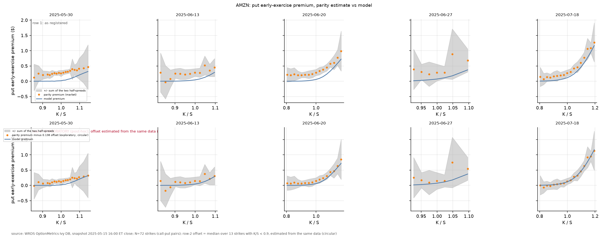

# Diagnostics of the Step 5 results (post-hoc)

Detail behind the [README](../README.md); the checks they follow from are in [market_check.md](market_check.md).

## What are the Step 5 failures made of?

Everything in this document is post-hoc: I designed it after the Step 5 verdicts were known. It is labelled `exploratory (post-hoc)` in code (`scripts/step6_diagnostics.py`), in the `status` column of `results/tables/diag_*.csv`, and in the figures, and changes no registered verdict. No fitted value is fed back into any pricing input. A replication snapshot was not run (`REPLICATION_DATE` is not set).

1. IV discretization at M=N = 400, 800, 1600 (contracts in the headline statistics: those with both BS and American IV and a bid-ask interval; vol points = 0.01 in IV):

<!-- table:discretization -->
|  | AMZN | SPY |
|---|---|---|
| contracts (headline set) | 151 | 592 |
| max abs IV(1600) - IV(800), vol pts | 0.0126 | 0.0253 |
| median abs IV(1600) - IV(800), vol pts | 0.0026 | 0.0025 |
| max abs IV(1600) - IV(400), vol pts | 0.0802 | 0.0902 |
| median abs IV(1600) - IV(400), vol pts | 0.0097 | 0.0106 |
| empirical order (from medians) | 1.84 | 2.02 |
| median per-contract order | 2.16 | 2.11 |
| median bid-ask IV half-width, vol pts | 0.2695 | 0.0328 |
| max abs IV(1600) - IV(400) / median half-width | 0.30 | 2.75 |
| share above own half-width: 1600 vs 800 | 0.000 | 0.000 |
| share above own half-width: 800 vs 400 | 0.000 | 0.030 |
| share above own half-width: 1600 vs 400 | 0.000 | 0.069 |
| share above own half-width: 400 vs Richardson limit | 0.000 | 0.081 |
<!-- /table:discretization -->

The registered pipeline (M=N=400) changes by at most 0.0902 vol points for SPY against a median half-width of 0.0328, so the registered requirement fails for SPY; 800 vs 1600 differ by at most 0.0253 (0.77 of the median half-width) and no contract changes by more than its own half-width between those two. The empirical order from the medians is 1.84 (AMZN) and 2.02 (SPY). The median half-width is 0.2695 vol points for AMZN and 0.0328 for SPY, and the requirement is met for AMZN. I did not replace the registered 400 pipeline.

Registered checks recomputed on the finer grids (headline contracts with IVs on all three grids; "Richardson" is IV(1600) + (IV(1600) - IV(800)) / 3, the limit for an order of about 2; half-widths stay the registered M=N=400 ones because bid and ask IVs were solved only there; the registered 400-grid verdicts are unchanged by this table). The "registered" column is recomputed here and reproduces `step5_hypothesis_checks.csv` to the printed precision:

<!-- table:grid_checks -->
| hypothesis | quantity | registered (M=N=400) | M=N=1600 | Richardson | surprise: registered / 1600 / Richardson |
|---|---|---|---|---|---|
| H1 | AMZN median put diff, ATM (K/S 0.98-1.02) | 0.00191 | 0.00212 | 0.00213 | False / False / False |
| H1 | SPY median put diff, ATM (K/S 0.98-1.02) | 0.00202 | 0.00229 | 0.00229 | False / False / False |
| H1 | AMZN median put diff, K/S <= 0.95 | 0.00043 | 0.00033 | 0.00034 | False / False / False |
| H1 | SPY median put diff, K/S <= 0.95 | 0.00107 | 0.00101 | 0.00101 | False / False / False |
| H1 | AMZN fraction of ITM puts (K/S >= 1.05, n=16) with diff > half-width | 0.68750 | 0.68750 | 0.68750 | False / False / False |
| H1 | SPY fraction of ITM puts (K/S >= 1.05, n=2) with diff > half-width | 1.00000 | 1.00000 | 1.00000 | False / False / False |
| H2 | AMZN max \|BS - American\| for calls 0.9<=K/S<=1.1 (n=52); expected ~0 only if q=0 | 0.00054 | 0.00003 | 0.00005 | False / False / False |
| H3 | AMZN strikes with market premium negative and entirely below zero by the band (of 72) | 0.00000 | 0.00000 | 0.00000 | False / False / False |
| H3 | AMZN mean market premium | 0.35857 | 0.35857 | 0.35857 | False / False / False |
| H4 | SPY mean \|call-put IV gap\|: American minus BS (negative = improvement) | 0.00914 | 0.00907 | 0.00906 | True / True / True |
| method | SPY max IV change vs the next finer answer (400 vs 1600; 1600 vs 800; 1600 vs Richardson); median half-width 0.00033 | 0.00090 | 0.00025 | 0.00008 | True / False / False |
<!-- /table:grid_checks -->

No H1-H4 verdict changes on either finer grid; H4 still fails (American minus BS is positive at every grid). The only flag that clears is the discretization requirement itself, which is by construction a statement about the 400 grid (SPY: largest change 0.00090 at 400 vs 1600, 0.00025 at 1600 vs 800, against a median half-width of 0.00033). The H2 maximum falls from 0.054 to 0.003 vol points, so most of the 400-grid H2 number was grid error. So the discretization caveat reduces to one line: the 400-grid SPY IVs carry grid error of up to about 0.09 vol points, which does not change any registered verdict.

2. SPY dividend-model split. BS-escrowed IV minus American spot-jump IV decomposes exactly into (BS minus European spot-jump) and (European spot-jump minus American); medians in vol points, expiries split by whether they are after the 2025-06-20 ex-date:

<!-- table:split -->
| side of ex-date | type | K/S | n | dividend model (BS - EU spot-jump) | early exercise (EU - American) | total @1600 | total @400 |
|---|---|---|---|---|---|---|---|
| after ex-date | call | (0.8, 0.9] | 7 | 0.041 | -0.000 | 0.041 | 0.049 |
| after ex-date | call | (0.9, 0.95] | 33 | 0.048 | 1.421 | 1.471 | 1.461 |
| after ex-date | call | (0.95, 1.05] | 128 | 0.031 | 0.207 | 0.237 | 0.221 |
| after ex-date | call | (1.05, 1.1] | 22 | 0.028 | 0.012 | 0.044 | 0.088 |
| after ex-date | call | (1.1, 1.2] | 10 | 0.025 | 0.000 | 0.025 | 0.093 |
| after ex-date | put | (0.8, 0.9] | 69 | 0.065 | 0.034 | 0.100 | 0.110 |
| after ex-date | put | (0.9, 0.95] | 69 | 0.049 | 0.067 | 0.116 | 0.114 |
| after ex-date | put | (0.95, 1.05] | 112 | 0.035 | 0.167 | 0.201 | 0.188 |
| after ex-date | put | (1.05, 1.1] | 2 | 0.025 | 1.598 | 1.623 | 1.615 |
| before ex-date | call | (0.8, 0.9] | 4 | 0.002 | 0.000 | 0.002 | 0.050 |
| before ex-date | call | (0.9, 0.95] | 20 | 0.001 | 0.000 | 0.001 | 0.013 |
| before ex-date | call | (0.95, 1.05] | 35 | -0.001 | 0.000 | -0.001 | -0.011 |
| before ex-date | call | (1.05, 1.1] | 6 | 0.003 | 0.000 | 0.003 | 0.080 |
| before ex-date | put | (0.8, 0.9] | 13 | 0.002 | 0.018 | 0.021 | 0.045 |
| before ex-date | put | (0.9, 0.95] | 29 | 0.000 | 0.038 | 0.039 | 0.046 |
| before ex-date | put | (0.95, 1.05] | 33 | -0.001 | 0.113 | 0.111 | 0.096 |
<!-- /table:split -->

For puts at K/S 0.8-0.95 the total of about 0.1 vol points is mostly the dividend model after the ex-date and mostly grid error before it (at 400 vs 1600). Early exercise is large only where it should be: calls at K/S 0.9-0.95 after the ex-date (about 1.4 vol points) and in-the-money puts (only 2 contracts at K/S 1.05-1.1, about 1.6). The K/S 0.8-0.9 call bucket has only 7 contracts in the headline set, so its median is not informative.

3. Per-expiry parity regression of (C_mid - P_mid) on K, both legs with relative spread at most 5%, compared with the model escrowed spot and OptionMetrics' `forward_price` (empty for every contract in this extract, so no comparison with the vendor forward is possible). Three variants, because the first one is confounded: it regresses on American puts whose early-exercise value grows with K, which pushes the fitted slope below -1.

- registered set: 0.95 <= K/S <= 1.05, raw mids (the original set, uncorrected).
- model premium negligible: 0.85 <= K/S <= 1.05, keeping only strikes where the model early-exercise premium of both legs is below $0.01 (premium from the American PDE minus the European PDE at the out-of-the-money leg's IV).
- model premium subtracted: 0.85 <= K/S <= 1.05, (C - P) minus the model premium of the call and of the put (this depends on the model).

Expiries with fewer than three qualifying strikes are omitted. Standard errors are OLS and ignore that mids of neighbouring strikes are correlated. No fitted value is used as a pricing input.

<!-- table:parity -->
| variant | underlying | expiry | n | slope ± se | implied rate ± se | model rate | intercept ± se | model escrowed spot | fixed-slope intercept ± se | offset vs escrowed spot, $ | vendor forward (non-null) |
|---|---|---|---|---|---|---|---|---|---|---|---|
| registered set (K/S 0.95-1.05, raw) | AMZN | 2025-05-30 | 9 | -1.0025 ± 0.0007 | -0.060 ± 0.017 | 0.0460 | 205.78 ± 0.15 | 205.17 | 204.89 ± 0.01 | -0.28 | 0 |
| registered set (K/S 0.95-1.05, raw) | AMZN | 2025-06-13 | 5 | -1.0090 ± 0.0048 | -0.113 ± 0.060 | 0.0456 | 207.45 ± 0.98 | 205.17 | 204.86 ± 0.05 | -0.31 | 0 |
| registered set (K/S 0.95-1.05, raw) | AMZN | 2025-06-20 | 5 | -1.0040 ± 0.0006 | -0.040 ± 0.006 | 0.0454 | 206.62 ± 0.12 | 205.17 | 204.88 ± 0.03 | -0.29 | 0 |
| registered set (K/S 0.95-1.05, raw) | AMZN | 2025-07-18 | 5 | -1.0035 ± 0.0019 | -0.020 ± 0.011 | 0.0447 | 207.21 ± 0.39 | 205.17 | 204.89 ± 0.04 | -0.28 | 0 |
| model premium negligible (both legs < $0.01, K/S 0.85-1.05) | AMZN | 2025-05-30 | 5 | -1.0028 ± 0.0019 | -0.069 ± 0.046 | 0.0460 | 205.85 ± 0.37 | 205.17 | 204.94 ± 0.01 | -0.23 | 0 |
| model premium negligible (both legs < $0.01, K/S 0.85-1.05) | AMZN | 2025-06-13 | 3 | -1.0125 ± 0.0107 | -0.156 ± 0.133 | 0.0456 | 207.96 ± 1.98 | 205.17 | 204.98 ± 0.06 | -0.19 | 0 |
| model premium negligible (both legs < $0.01, K/S 0.85-1.05) | AMZN | 2025-06-20 | 3 | -0.9925 ± 0.0020 | 0.076 ± 0.021 | 0.0454 | 204.41 ± 0.36 | 205.17 | 204.96 ± 0.01 | -0.21 | 0 |
| model premium subtracted (K/S 0.85-1.05) | AMZN | 2025-05-30 | 12 | -1.0000 ± 0.0005 | 0.000 ± 0.012 | 0.0460 | 205.31 ± 0.10 | 205.17 | 204.93 ± 0.01 | -0.24 | 0 |
| model premium subtracted (K/S 0.85-1.05) | AMZN | 2025-06-13 | 8 | -1.0010 ± 0.0021 | -0.012 ± 0.026 | 0.0456 | 205.85 ± 0.41 | 205.17 | 204.94 ± 0.03 | -0.23 | 0 |
| model premium subtracted (K/S 0.85-1.05) | AMZN | 2025-06-20 | 9 | -0.9961 ± 0.0004 | 0.040 ± 0.004 | 0.0454 | 205.06 ± 0.08 | 205.17 | 204.96 ± 0.01 | -0.21 | 0 |
| model premium subtracted (K/S 0.85-1.05) | AMZN | 2025-07-18 | 9 | -0.9933 ± 0.0004 | 0.038 ± 0.002 | 0.0447 | 205.25 ± 0.08 | 205.17 | 205.03 ± 0.01 | -0.14 | 0 |
| registered set (K/S 0.95-1.05, raw) | SPY | 2025-06-13 | 33 | -1.0064 ± 0.0011 | -0.081 ± 0.013 | 0.0456 | 595.62 ± 0.62 | 590.46 | 589.81 ± 0.02 | -0.65 | 0 |
| registered set (K/S 0.95-1.05, raw) | SPY | 2025-06-27 | 30 | -1.0109 ± 0.0002 | -0.092 ± 0.002 | 0.0452 | 597.80 ± 0.11 | 588.71 | 588.37 ± 0.04 | -0.34 | 0 |
| registered set (K/S 0.95-1.05, raw) | SPY | 2025-06-30 | 40 | -1.0078 ± 0.0002 | -0.062 ± 0.002 | 0.0452 | 595.99 ± 0.11 | 588.71 | 588.13 ± 0.03 | -0.58 | 0 |
| registered set (K/S 0.95-1.05, raw) | SPY | 2025-07-18 | 21 | -1.0089 ± 0.0013 | -0.051 ± 0.008 | 0.0447 | 597.69 ± 0.79 | 588.71 | 587.84 ± 0.05 | -0.87 | 0 |
| model premium negligible (both legs < $0.01, K/S 0.85-1.05) | SPY | 2025-06-13 | 13 | -0.9966 ± 0.0001 | 0.043 ± 0.002 | 0.0456 | 590.02 ± 0.07 | 590.46 | 589.92 ± 0.00 | -0.54 | 0 |
| model premium subtracted (K/S 0.85-1.05) | SPY | 2025-06-13 | 58 | -0.9969 ± 0.0001 | 0.039 ± 0.001 | 0.0456 | 590.20 ± 0.04 | 590.46 | 589.92 ± 0.00 | -0.54 | 0 |
| model premium subtracted (K/S 0.85-1.05) | SPY | 2025-06-27 | 38 | -0.9928 ± 0.0001 | 0.062 ± 0.001 | 0.0452 | 586.89 ± 0.05 | 588.71 | 587.98 ± 0.01 | -0.73 | 0 |
| model premium subtracted (K/S 0.85-1.05) | SPY | 2025-06-30 | 99 | -0.9928 ± 0.0001 | 0.057 ± 0.001 | 0.0452 | 587.09 ± 0.05 | 588.71 | 587.91 ± 0.01 | -0.79 | 0 |
| model premium subtracted (K/S 0.85-1.05) | SPY | 2025-07-18 | 34 | -0.9912 ± 0.0002 | 0.050 ± 0.001 | 0.0447 | 587.64 ± 0.10 | 588.71 | 588.21 ± 0.01 | -0.50 | 0 |
<!-- /table:parity -->

The confound is real and accounts for the sign of the raw result. In the raw fit every slope is below -1 (-1.0025 to -1.0109), which implies a negative interest rate. Once the model premium is removed the slopes are -1.0010 to -0.9912 (premium subtracted; the negligible-premium fits are noisier, with only 3 to 13 strikes) and the implied rates are no longer systematically negative, (-0.012 to 0.062) against model rates of 0.045 to 0.046. The slope standard errors are small for SPY (OLS, correlated errors ignored), so the SPY slopes still differ from -1 in OLS terms and the implied SPY rates (0.039 to 0.062) are not an estimate of the model rate; I do not interpret them as one.

The offset in the fixed-slope intercept partly survives. With the slope fixed at the model discount factor, the implied spot minus the model escrowed spot is -$0.14 to -$0.24 for AMZN in the premium-subtracted fits (-$0.28 to -$0.31 in the raw fits) and -$0.50 to -$0.79 for SPY (-$0.34 to -$0.87 raw). The before-ex-date SPY expiry, where the premium is negligible and no dividend is involved, gives -$0.54 in the negligible-premium and subtracted fits (-$0.65 in the raw fit). So the premium confound explains the negative rates and part of the AMZN offset size, but not the offset itself. Hypothesis, untested: a spot or quote-timing offset (SPY options trade until 16:15 ET against a 16:00 spot); a borrow, dividend-yield or rate difference would also fit and I have not separated them.

4. SPY model-free call bound S - K exp(-r t_d) (hold to the ex-date and exercise cum-dividend), calls after the ex-date, count of asks below the bound:

<!-- table:bound -->
| by | group | calls | ask below bound | bid below bound | min (ask - bound), $ | median (ask - bound), $ |
|---|---|---|---|---|---|---|
| all | all | 262 | 0 | 62 | 1.11 | 6.19 |
| expiry | 2025-06-27 | 47 | 0 | 5 | 1.51 | 6.43 |
| expiry | 2025-06-30 | 138 | 0 | 52 | 1.11 | 3.02 |
| expiry | 2025-07-18 | 77 | 0 | 5 | 1.34 | 16.47 |
| moneyness | (0.8, 0.9] | 60 | 0 | 53 | 1.11 | 1.74 |
| moneyness | (0.9, 0.95] | 42 | 0 | 9 | 2.00 | 2.73 |
| moneyness | (0.95, 1.05] | 128 | 0 | 0 | 3.59 | 11.27 |
| moneyness | (1.05, 1.1] | 22 | 0 | 0 | 28.69 | 37.63 |
| moneyness | (1.1, 1.2] | 10 | 0 | 0 | 56.84 | 64.37 |
<!-- /table:bound -->

No ask is below the bound (minimum slack $1.11), so the bound is not violated; it is also too loose to test the model's early-exercise premium. 62 bids are below it, which is not an arbitrage (one would pay the ask).

Call-put gap in dollars (the H4 gap restated in prices). For every call-put pair, market (C - P) minus the American model's (C - P) at the IV of the out-of-the-money leg, in dollars, against the sum of the two quoted half-spreads, by wing (the deep in-the-money-call wing is K/S < 0.93). The last column converts the dollar gap into the call IV shift that would produce it, using the call's vega:

<!-- table:dollar_gap -->
| underlying | side | K/S wing | pairs | market - model (C - P), $ | se, $ | mean abs, $ | mean sum of two half-spreads, $ | share within the half-spreads | median call vega, $ per 1.00 vol | median abs implied call IV shift, vol pts |
|---|---|---|---|---|---|---|---|---|---|---|
| AMZN | no dividend | 0.93 <= K/S <= 1.03 | 24 | -0.211 | 0.009 | 0.211 | 0.137 | 0.12 | 22.8 | 0.96 |
| AMZN | no dividend | K/S < 0.93 | 22 | -0.178 | 0.018 | 0.181 | 0.248 | 0.64 | 11.2 | 1.65 |
| AMZN | no dividend | K/S > 1.03 | 26 | -0.228 | 0.023 | 0.228 | 0.295 | 0.65 | 14.9 | 1.61 |
| SPY | after ex-date | 0.93 <= K/S <= 1.03 | 102 | -0.692 | 0.012 | 0.692 | 0.165 | 0.00 | 75.5 | 0.96 |
| SPY | after ex-date | K/S < 0.93 | 84 | -0.792 | 0.012 | 0.792 | 1.264 | 0.86 | 27.4 | 2.82 |
| SPY | after ex-date | K/S > 1.03 | 13 | -0.617 | 0.023 | 0.617 | 0.678 | 0.46 | 58.5 | 1.06 |
| SPY | before ex-date | 0.93 <= K/S <= 1.03 | 43 | -0.544 | 0.002 | 0.544 | 0.078 | 0.00 | 50.3 | 1.07 |
| SPY | before ex-date | K/S < 0.93 | 14 | -0.536 | 0.001 | 0.536 | 0.092 | 0.00 | 22.3 | 2.42 |
| SPY | before ex-date | K/S > 1.03 | 1 | -0.613 | n/a | 0.613 | 0.340 | 0.00 | 49.4 | 1.24 |
<!-- /table:dollar_gap -->

- Deep in-the-money calls (K/S < 0.93): largely a vega and spread effect. After the ex-date the mean dollar gap is $0.792 against a mean sum of half-spreads of $1.264, and 86% of those pairs lie inside their quoted half-spreads, yet the same dollars are a median 2.82 vol points because the call vega is only about 27. The registered H4 failure in this wing (American 3.65 vs BS 1.17 vol points) is therefore mostly a small-vega amplification of a dollar gap the quotes cannot resolve.
- Middle wing (0.93 <= K/S <= 1.03): not a vega effect. The gap is $0.692 after the ex-date and $0.544 before it, about 5 to 7 times the sum of the half-spreads (median ratio), and none of the pairs lie inside them, although it is only about 1 vol point because the vega is large. The model and the quotes disagree there by more than the quote width.
- The dollar gap is roughly the same size in every wing (about $0.54 for SPY before the ex-date, $0.62 to $0.79 after it, about $0.2 for AMZN) and has the same sign as the parity-intercept offset in section 3. That points at an input common to all strikes (spot, timing, rate, borrow) rather than at the early-exercise model; the cause is not isolated.
- Dividend input checked. The model uses the `distrd` row (one cash dividend of 1.76112, ex-date 2025-06-20, present value 1.7533 at the snapshot). The expiry before the ex-date (2025-06-13) has the same -$0.54 gap with no dividend in play, so the dividend amount and the ex-date mapping do not explain it.

Standard errors in the table treat strikes as independent and are too small.

5. SPY H4 by wing (IV gap = call IV - put IV; "American smaller" is the fraction of pairs where |American gap| < |BS gap|; two grids because the before-ex-date fractions are grid sensitive):

<!-- table:wings -->
| wing | side of ex-date | pairs | mean abs gap, BS (vol pts) | mean abs gap, American @400 | American smaller @400 | American smaller @1600 |
|---|---|---|---|---|---|---|
| K/S < 0.93 | all | 80 | 1.17 | 3.65 | 0.28 | 0.31 |
| K/S < 0.93 | before ex-date | 14 | 3.51 | 3.50 | 0.79 | 1.00 |
| K/S < 0.93 | after ex-date | 66 | 0.67 | 3.68 | 0.17 | 0.17 |
| 0.93 <= K/S <= 1.03 | all | 145 | 0.83 | 1.08 | 0.49 | 0.50 |
| 0.93 <= K/S <= 1.03 | before ex-date | 43 | 1.30 | 1.19 | 1.00 | 1.00 |
| 0.93 <= K/S <= 1.03 | after ex-date | 102 | 0.63 | 1.03 | 0.27 | 0.28 |
| K/S > 1.03 | all | 14 | 2.56 | 1.35 | 1.00 | 1.00 |
| K/S > 1.03 | before ex-date | 1 | 2.44 | 1.38 | 1.00 | 1.00 |
| K/S > 1.03 | after ex-date | 13 | 2.56 | 1.34 | 1.00 | 1.00 |
| all wings | all | 239 | 1.04 | 1.95 | 0.45 | 0.46 |
| all wings | before ex-date | 58 | 1.85 | 1.75 | 0.95 | 1.00 |
| all wings | after ex-date | 181 | 0.78 | 2.02 | 0.29 | 0.29 |
<!-- /table:wings -->

H4 is not uniformly worse: the American gap is smaller for K/S > 1.03 (14 pairs) and before the ex-date, and much larger for K/S < 0.93 after the ex-date (66 pairs). Pairs are not independent and the wings are unequal in size, so this is a description of where the registered failure sits, not a test.

6. AMZN premium with a median offset subtracted (row 2 of Figure 6). The offset is the median of (market - model) premium over the 13 strikes with K/S < 0.9, where the model premium is about zero: 0.138 (interquartile 0.105 to 0.211). Subtracting it raises the share of strikes inside the propagated band from 0.472 to 0.889. This improvement is circular: the offset is estimated from the same strikes it is then applied to (the K/S < 0.9 bucket reaches 1.000 by construction), so it is not evidence for any explanation of the offset:

<!-- table:offset -->
| strikes | n | mean market - model | mean adjusted - model | within band, registered | within band, offset subtracted (circular) |
|---|---|---|---|---|---|
| all | 72 | 0.208 | 0.070 | 0.472 | 0.889 |
| K/S 0.0-0.9 | 13 | 0.151 | 0.014 | 0.846 | 1.000 |
| K/S 0.9-0.95 | 10 | 0.216 | 0.078 | 0.300 | 1.000 |
| K/S 0.95-1.05 | 29 | 0.240 | 0.102 | 0.138 | 0.724 |
| K/S 1.05-9.0 | 20 | 0.195 | 0.057 | 0.800 | 1.000 |
<!-- /table:offset -->

Figure 6. AMZN put early-exercise premium, parity estimate vs model, by expiry. Row 1 as registered; row 2 with the K/S < 0.9 median offset subtracted (circular: the offset comes from the same data). The market premium sits above the model by a roughly constant amount.

<!-- caption:step6_amzn_premium_two_row -->
*Provenance (generated from `results/figures/figure_manifest.csv`, the text printed on the figure):* source: WRDS OptionMetrics Ivy DB, snapshot 2025-05-15 16:00 ET close; N=72 strikes (call-put pairs); row-2 offset = median over 13 strikes with K/S < 0.9, estimated from the same data (circular)
<!-- /caption:step6_amzn_premium_two_row -->