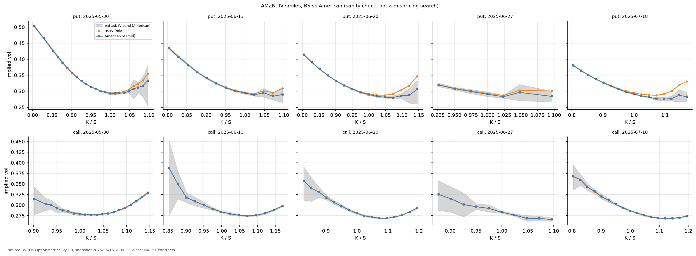
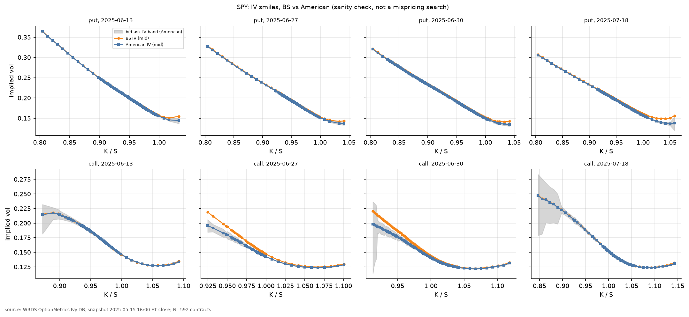
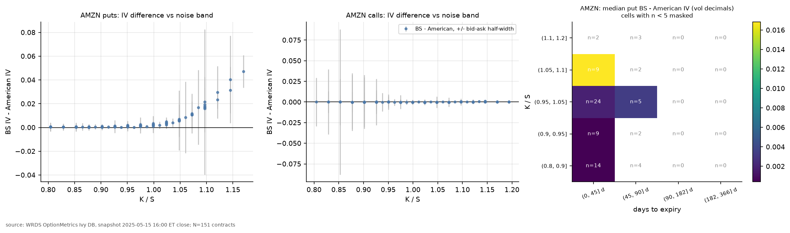
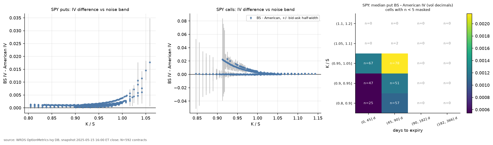
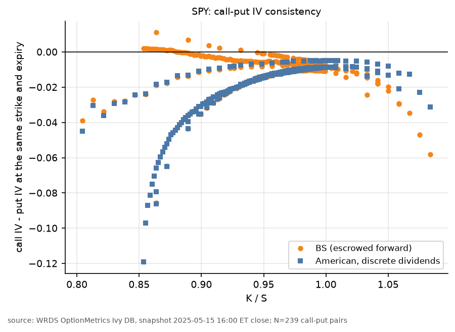

# Market check: AMZN and SPY, 2025-05-15

Detail behind the market-check section of the [README](../README.md). The diagnostics that were added after seeing these results are in [diagnostics.md](diagnostics.md).

## Does the model pass a market sanity check? (Step 5, predictions stated in advance)

Provenance. I wrote my predictions in docs/hypotheses_step5.md before running the analysis, but the committed copy was made after the results, so I can't prove the timing. The code gate (`parse_hypotheses`) accepts the committed file, which has no `status` line; an explicit non-CONFIRMED status or any TBD field aborts.

Data. WRDS OptionMetrics Ivy DB pulled 2026-11-03; snapshot 2025-05-15, end-of-day (quote and spot both taken as the 16:00 ET close). The first-choice date 2026-05-13 is beyond the end of the WRDS data (2025-08-29), so the registered fallback to the same quarter a year earlier was used. AMZN pays no dividend; SPY has one cash dividend in the window (ex-date 2025-06-20, 1.76112, `distr_type` 1). Expiries are the listed expiries nearest 14, 28, 42, 56 and 64 days. Cleaning (thresholds registered before the run):

<!-- table:cleaning -->
|  | AMZN | SPY |
|---|---|---|
| rejected: bid <= 0 | 24 | 0 |
| rejected: spread > 10% | 116 | 74 |
| rejected: open interest < 10 | 117 | 340 |
| rejected: below intrinsic | 9 | 0 |
| rejected: K/S outside [0.8, 1.2] | 64 | 153 |
| rejected: no BS IV | 1 | 1 |
| contracts after cleaning | 161 | 660 |
| surviving at spread 5% | 136 | 646 |
| surviving at spread 10% | 161 | 660 |
| surviving at spread 20% | 164 | 666 |
<!-- /table:cleaning -->

Registered checks and verdicts (`results/tables/step5_hypothesis_checks.csv`, written by `scripts/step5_market.py`; IV values in decimals, 0.01 = one vol point). "Triggered" means the registered surprise condition was met. Verdicts as registered:

<!-- table:checks -->
| hypothesis | quantity | measured | registered surprise threshold | triggered |
|---|---|---|---|---|
| H1 | AMZN median put diff, ATM (K/S 0.98-1.02) | 0.00191 | > 0.006 | no |
| H1 | AMZN median put diff, K/S <= 0.95 | 0.00043 | > 0.003 | no |
| H1 | AMZN fraction of ITM puts (K/S >= 1.05, n=16) with diff > half-width | 0.68750 | not above half-width at all (0) | no |
| H2 | AMZN max \|BS - American\| for calls 0.9<=K/S<=1.1 (n=52); expected ~0 only if q=0 | 0.00054 | > 0.001 (0.1 vol points) | no |
| H1 | SPY median put diff, ATM (K/S 0.98-1.02) | 0.00202 | > 0.006 | no |
| H1 | SPY median put diff, K/S <= 0.95 | 0.00107 | > 0.003 | no |
| H1 | SPY fraction of ITM puts (K/S >= 1.05, n=2) with diff > half-width | 1.00000 | not above half-width at all (0) | no |
| H3 | AMZN strikes with market premium negative and entirely below zero by the band (of 72) | 0.00000 | any far outside the band | no |
| H3 | AMZN mean market premium | 0.35857 | negative | no |
| H4 | SPY mean \|call-put IV gap\|: American minus BS (negative = improvement) | 0.00914 | >= 0 (no improvement) | yes |
| method | max \|IV(400) - IV(1600)\| in the discretization check (SPY); median half-width 0.00033 | 0.00086 | must be much smaller than the median half-width (here: > half-width flagged) | yes |
<!-- /table:checks -->

- H1 (BS minus American put IV): supported. Median gap at the money 0.19 vol points (AMZN) and 0.20 (SPY); for K/S <= 0.95, 0.04 and 0.11; all inside the registered limits (0.6 and 0.3). The fraction of puts whose gap exceeds the American half-width is 0.30 for AMZN and 0.95 for SPY.
- H2 (AMZN calls equal European): supported. Maximum |BS - American| 0.05 vol points for 0.9 <= K/S <= 1.1 (threshold 0.1; the script tests the maximum, stricter than the registered median).
- H3 (AMZN parity premium): not as predicted, although the registered surprise condition (a negative premium far outside the band) was not triggered. I predicted a small model premium and an inconclusive test near the money. Measured: the market premium averages 0.36, the model premium 0.15, and only 47% of strikes lie inside the propagated band. The offset is positive at every expiry and moneyness bucket, not growing with moneyness.
- H4 (SPY call-put gap shrinks under the American model): not supported. The mean absolute call-put IV gap is 1.95 vol points under the American model and 1.04 under BS; the American gap is smaller for 45% of the 239 pairs.
- H5 (vendor IV): supported on size. Median |my American IV - vendor| is 0.012 vol points (AMZN) and 0.049 (SPY); the signed medians are small. The vendor IV lies inside my American bid-ask IV interval for 100% of AMZN and 47% of SPY contracts, because the SPY intervals are narrower than the vendor difference.
- Discretization requirement (IV error at M=N=400 much smaller than the half-width): failed for SPY, passed for AMZN. Measured on the full headline sets in [diagnostics.md](diagnostics.md).

Bootstrap intervals (contracts resampled within expiry; neighbouring strikes are not independent, so these are too narrow) and the vendor comparison:

<!-- table:bootstrap -->
| statistic | n | estimate | 95% CI low | 95% CI high |
|---|---|---|---|---|
| AMZN: median put IV diff (BS - American) | 74 | 0.0013 | 0.0008 | 0.0025 |
| AMZN: fraction \|BS - American\| > half-width (puts) | 74 | 0.2973 | 0.2159 | 0.3784 |
| SPY: median put IV diff (BS - American) | 327 | 0.0012 | 0.0011 | 0.0012 |
| SPY: fraction \|BS - American\| > half-width (puts) | 327 | 0.9511 | 0.9266 | 0.9725 |
| AMZN: mean (market - model) put premium | 72 | 0.2079 | 0.1917 | 0.2274 |
| SPY: mean \|call-put gap\| American | 239 | 0.0195 | 0.0175 | 0.0217 |
| SPY: mean \|call-put gap\| BS | 239 | 0.0104 | 0.0094 | 0.0116 |
<!-- /table:bootstrap -->

<!-- table:vendor -->
| underlying | n | median abs diff (vol pts) | p95 abs diff (vol pts) | median signed vendor - mine (vol pts) | vendor inside my interval |
|---|---|---|---|---|---|
| AMZN | 151 | 0.012 | 0.048 | -0.007 | 1.00 |
| SPY | 592 | 0.049 | 0.115 | 0.024 | 0.47 |
<!-- /table:vendor -->

Sensitivity (`step5_d_sensitivity.csv`): shifting r by 50bp moves the AMZN parity-premium offset by 0.52 times the model premium, a 0.05% spot shift by 0.68 to 0.69 times, and the SPY American call-put gap by 0.61 (r) and 0.60 to 0.69 (spot) times the BS-vs-American difference; dividends ±10% move the SPY gap by 0.14 to 0.16 times. Input uncertainty of this size is comparable to the effects being read, so none of the Step 5 gaps can be attributed to the model alone.

Figure 1. AMZN IV smiles by expiry, BS vs American, with the American bid-ask IV band. The two IVs coincide for calls and separate only for in-the-money puts.

<!-- caption:step5_a_smiles_AMZN -->
*Provenance (generated from `results/figures/figure_manifest.csv`, the text printed on the figure):* source: WRDS OptionMetrics Ivy DB, snapshot 2025-05-15 16:00 ET close; N=151 contracts
<!-- /caption:step5_a_smiles_AMZN -->

Figure 2. SPY IV smiles, same layout. BS and American IV differ by a few tenths of a vol point except for in-the-money puts and for calls just after the ex-date.

<!-- caption:step5_a_smiles_SPY -->
*Provenance (generated from `results/figures/figure_manifest.csv`, the text printed on the figure):* source: WRDS OptionMetrics Ivy DB, snapshot 2025-05-15 16:00 ET close; N=592 contracts
<!-- /caption:step5_a_smiles_SPY -->

Figure 3. AMZN BS minus American IV against K/S, with the bid-ask half-width, and the median put difference by moneyness and maturity bucket (counts printed; cells with fewer than 5 contracts masked; K/S increases upwards). Where the difference exceeds its noise band.

<!-- caption:step5_a_difference_AMZN -->
*Provenance (generated from `results/figures/figure_manifest.csv`, the text printed on the figure):* source: WRDS OptionMetrics Ivy DB, snapshot 2025-05-15 16:00 ET close; N=151 contracts
<!-- /caption:step5_a_difference_AMZN -->

Figure 4. The same for SPY. A floor of about 0.1 vol point across the money.

<!-- caption:step5_a_difference_SPY -->
*Provenance (generated from `results/figures/figure_manifest.csv`, the text printed on the figure):* source: WRDS OptionMetrics Ivy DB, snapshot 2025-05-15 16:00 ET close; N=592 contracts
<!-- /caption:step5_a_difference_SPY -->

Figure 5. SPY call IV minus put IV at the same strike and expiry, BS vs American. The registered H4 failure.

<!-- caption:step5_c_call_put_gap_SPY -->
*Provenance (generated from `results/figures/figure_manifest.csv`, the text printed on the figure):* source: WRDS OptionMetrics Ivy DB, snapshot 2025-05-15 16:00 ET close; N=239 call-put pairs
<!-- /caption:step5_c_call_put_gap_SPY -->

## Limitations (full list)

- Tolerances come from measurements. Test tolerances were set from observed values (stated in each test comment), not derived; the boundary-jump and escrow bands are sanity bands that pin sign and rough size.
- The registered discretization check failed for SPY at M=N=400, but recomputing H1-H4 on the 1600-grid and Richardson IVs changes no verdict (diagnostics.md, section 1); the registered pipeline was not replaced.
- Dividend model vs early exercise is confounded in the SPY BS-minus-American gap: BS uses the escrowed model, the American IV the spot-jump model, so the gap contains both (diagnostics.md, section 2 separates them).
- Provenance. I wrote my predictions before running the analysis, but the committed copy was made after the results, so I can't prove the timing.
- The diagnostics were designed after seeing the results and are not tests; standard errors and bootstrap intervals treat neighbouring strikes as independent and are too narrow.
- Volatility regime. The snapshot (2025-05-15) is about five weeks after the early-April 2025 tariff-related selloff, so implied volatility was probably elevated; the median at-the-money American IVs are in the table below. I did not measure other dates, so I cannot say how unusual this level is, and the size of the gaps (especially early-exercise effects, which scale with volatility and rates) may differ on a calmer date. A replication on a calmer date would address this; it was not run (`REPLICATION_DATE` unset).

<!-- table:snapshot_level -->
| underlying | expiry | days | n | median ATM American IV (vol pts) |
|---|---|---|---|---|
| AMZN | all | all | 14 | 28.84 |
| AMZN | 2025-05-30 | 15 | 6 | 28.67 |
| AMZN | 2025-06-13 | 29 | 2 | 28.93 |
| AMZN | 2025-06-20 | 36 | 2 | 28.52 |
| AMZN | 2025-06-27 | 43 | 2 | 28.71 |
| AMZN | 2025-07-18 | 64 | 2 | 28.94 |
| SPY | all | all | 136 | 15.24 |
| SPY | 2025-06-13 | 29 | 28 | 15.67 |
| SPY | 2025-06-27 | 43 | 28 | 15.26 |
| SPY | 2025-06-30 | 46 | 42 | 14.68 |
| SPY | 2025-07-18 | 64 | 38 | 15.52 |
<!-- /table:snapshot_level -->

- One snapshot, two underlyings, end-of-day quotes. SPY options trade until 16:15 ET while the spot is the 16:00 close; the AMZN and SPY parity offsets could be spot, timing, borrow or rate and were not isolated (diagnostics.md, section 3; a hypothesis only). OptionMetrics' `forward_price` is empty in this extract, so no comparison with the vendor forward was possible.
- Inputs are uncertain by as much as the effects read: see the sensitivity paragraph above.
- Data is licensed and not redistributed. `data/` is gitignored; per-contract tables derived from vendor quotes are written to `data/derived/` and not committed; `results/tables/` holds aggregates. Figures 1-4 plot per-contract derived implied vols, and earlier commits (before Step 6) contain per-contract tables; check UMD's WRDS terms before publishing anything beyond aggregates.
- Synthetic fixtures only in CI: tests use `tests/fixtures/`; there is no vendor data, network or credential in the test suite.
- Audit scope. `scripts/audit_readme_numbers.py` checks the generated tables, the figure provenance lines (N, snapshot date, source, read back from `results/figures/figure_manifest.csv`) and the prose numbers listed in `scripts/audit_claims.py`. The caption sentences and the model-only figure parameters are hand-written; docs/steps_1_4.md carries no result numbers outside generated tables.