# Steps 1-4: tree, PDE, Monte Carlo and dividends

Detail behind the summary in the [README](../README.md). Every result number below is in a generated table (`scripts/build_readme_tables.py`, checked by `scripts/audit_readme_numbers.py`) or in a figure.

## Methods

| Piece | Module | Notes |
|---|---|---|
| Parameters, Black-Scholes | `src/aopt/params.py`, `bs.py` | frozen validated `OptionParams`; `dividends=((t, D), ...)` discrete cash dividends |
| Binomial tree | `src/aopt/tree.py` | CRR, O(N) memory; averaging and Richardson reference (`reference.py`); dividends by interpolating the post-dividend layer; escrowed tree for model-risk sizing |
| PDE | `src/aopt/pde.py` | Crank-Nicolson on a log-price grid; Rannacher startup (four implicit half-steps) smooths the payoff kink; American exercise by PSOR (red-black) or a penalty method (semi-smooth Newton), which agree to about 1e-8 in price, penalty being 4-5x faster; dividends are forced step boundaries with a cubic-spline jump condition |
| LSM | `src/aopt/lsm.py` | exact GBM, regression on in-the-money paths; in-sample (policy and value from the same paths, biased high at small samples) vs out-of-sample (independent evaluation set, unbiased low); targets the Bermudan tree benchmark on the same dates (`reference.py::bermudan_reference`) |
| Dividend model | `tree.py`, `pde.py`, `lsm.py` | spot-jump: the spot falls by D at the ex-date, exercise allowed cum-dividend; the escrowed model (price on S minus PV of dividends) is a different model, used for comparison and for the BS implied vols |
| Market-data pipeline | `src/aopt/market/` | loaders that assert units and flags, zero-curve rates, `distrd` dividends, cleaning with a reject log, BS and American implied vol |

Details of each design choice and its measured behaviour are in the [notes on each step](#notes-on-each-step) below, and the market check is in [market_check.md](market_check.md).

## Results

###  How accurate and how costly are the three methods? (Steps 1-3)

- Tree: first order, oscillating; averaging plus Richardson gives the reference 6.090371. PDE: observed order about 1.9, agreeing with the tree reference to 8.0e-6 after Richardson (an agreement check, not a proof).
- LSM against its correct Bermudan target (S=K=100, 50 exercise dates, laguerre degree 3, 30 seeds):

<!-- table:lsm_paths -->
| training paths | in-sample mean (sd across seeds) | out-of-sample mean (sd across seeds) |
|---|---|---|
| 1,000 | 6.2744 (0.1655) | 6.0088 (0.0311) |
| 10,000 | 6.1123 (0.0312) | 6.0647 (0.0042) |
| 100,000 | 6.0781 (0.0124) | 6.0760 (0.0010) |
| 1,000,000 | 6.0738 (0.0034) | 6.0775 (0.0003) |
<!-- /table:lsm_paths -->

This table scores every fit on one common 2M-path evaluation set, which suits comparing policies and spreads across seeds but adds one shared offset of about that set's own standard error (0.0030) to every out-of-sample level; the bias decomposition below uses a fresh evaluation set per seed for the level.

- Bias decomposition at 1,000,000 training paths:

<!-- table:bias_decomposition -->
| component | value | error |
|---|---|---|
| discretization (American - Bermudan benchmark) | 0.01177 | 0.00006 |
| regression/policy (Bermudan benchmark - mean out-of-sample LSM) | 0.00557 | 0.00047 |
| total (American - mean out-of-sample LSM) | 0.01734 | 0.00047 |
| Monte Carlo standard error of ONE run (out-of-sample) | 0.00304 | n/a |
| policy term in units of its standard error (z) | 11.98000 | n/a |
| mean in-sample LSM minus Bermudan benchmark | -0.00484 | 0.00062 |
<!-- /table:bias_decomposition -->

Bermudan benchmark by number of exercise dates (American reference 6.090371); the shortfall halves as the number of dates doubles (first order in the date spacing):

<!-- table:bermudan_nex -->
| n_ex | 2 | 5 | 10 | 25 | 50 | 100 |
|---|---|---|---|---|---|---|
| Bermudan price | 5.8388 | 5.9812 | 6.0337 | 6.0672 | 6.0786 | 6.0845 |
| American - Bermudan | 0.2516 | 0.1092 | 0.0567 | 0.0232 | 0.0118 | 0.0059 |
<!-- /table:bermudan_nex -->

### What do discrete dividends change? (Step 4)

The dividend model matters more than the numerical method. Escrowed-tree vs spot-jump prices (N=4000) against the PDE-vs-tree reference uncertainty:

<!-- table:model_risk -->
| scenario | spot-jump reference | PDE vs tree gap | escrowed tree | model difference (American) |
|---|---|---|---|---|
| one_dividend_put | 7.4073 | 8.4e-6 | 7.2780 | -0.129 |
| quarterly_put | 7.2037 | 5.2e-5 | 7.0826 | -0.121 |
| large_dividend_call | 7.9144 | 4.8e-5 | 7.6413 | -0.273 |
<!-- /table:model_risk -->

The put is never exercised cum-dividend when `D/(rK)` exceeds the time to the ex-date, the put boundary jumps up across the ex-date, and the American call is European when D is below the Merton threshold (see Validation). LSM on the large-dividend call has a measured policy shortfall (table in the notes on Step 4 below) that I report as a limitation and did not tune away. Details in the notes on each step below.

## Notes on each step

Result numbers here are in generated, audited tables or in figures; the prose carries design notes only. Test tolerances and the measured values they were set from are in the test comments (`tests/`), and the headline checks are in the Validation table.

### Methodology notes

- Tree: CRR, `u = exp(sigma*sqrt(dt))`, `p = (exp((r-q)dt) - d)/(u - d)`; raises `ValueError` if `p` is outside [0, 1].
- Boundary: at each step, S*(t) is the extreme node where exercise strictly beats continuation (puts: largest S; calls: smallest S); NaN if no node qualifies. It is a step function with resolution about `S*sigma*sqrt(dt)`, so tests use node-spacing tolerances.
- Reference price: `A(N) = (V_N + V_{N+1})/2` damps CRR oscillation; `R(N) = 2A(2N) - A(N)` removes the leading 1/N term. The reported price is `R` from `A(4N), A(2N)`; the error estimate is the gap between two successive Richardson values (empirical, not a bound).
- Perpetual put check (q = 0): try `V = A*S^(-b)` in `0.5*sigma^2*S^2*V'' + r*S*V' - r*V = 0`; this requires `0.5*sigma^2*b*(b+1) - r*b - r = 0`, so `b = 2r/sigma^2` is the decaying root. Value matching and smooth pasting give `S* = K*b/(b+1)`. For r = 8%, σ = 40% this is b = 1 and S* = 50 (measured against the tree in the Validation table).

### Step 1: tree (S=K=100, T=1, r=5%, q=0, σ=20%, put)

The reference American put is the Richardson-extrapolated tree price (its value is in the Results tables above). Raw CRR error is first order and oscillates, averaging removes the oscillation, and Richardson is far more accurate but irregular (Figure A1); because the convergence slopes are not saved in a table I do not quote them, and I make no second-order claim for Richardson. The reference is built from the tree, so tree-vs-reference errors are partly self-referential; Step 2's PDE is the first independent check.

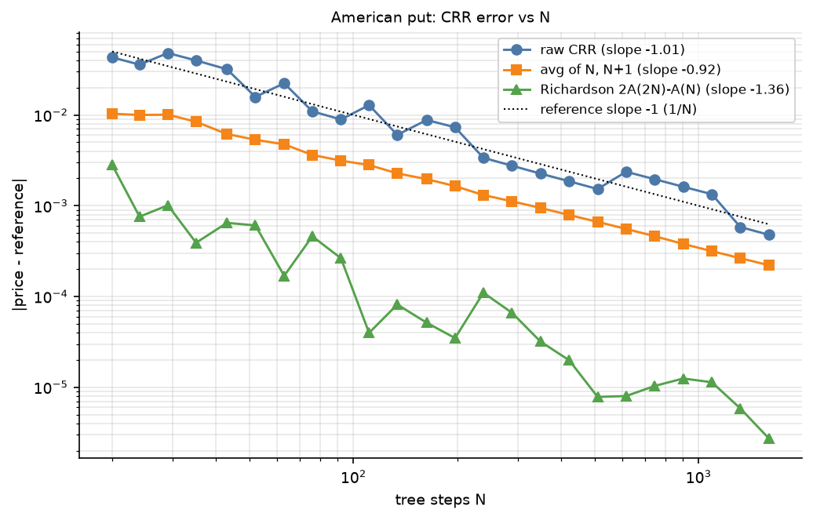

Figure A1. Tree price error vs N (raw, averaged, Richardson). Model-only: S=K=100, T=1, r=5%, σ=20%, put; N=20..1600; no market data. Raw CRR is first order and oscillates.

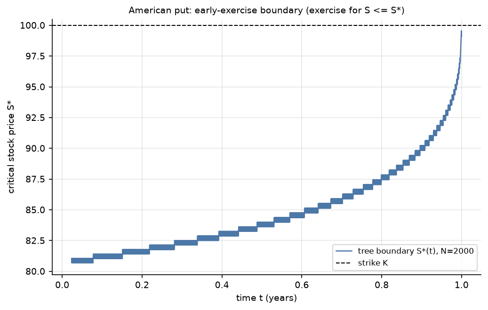

Figure A2. Tree exercise boundary S*(t). Model-only, same parameters; no market data. A step function with node-spacing resolution.

### Step 2: Crank-Nicolson PDE (same parameters; M = N)

Design: log-price grid on `[ln K - L, ln K + L]` with `L = max(5*sigma*sqrt(T) + |r-q|*T, 1.5)` (widened by `|ln(S0/K)|`), shifted by at most half a cell so S0 is exactly a node (no interpolation); Dirichlet boundaries `max(European asymptote, intrinsic)`. American exercise per time step by red-black PSOR (vectorized, auto-optimal omega) or a penalty method (semi-smooth Newton, `rho = 1e8`). Rannacher: the first two CN steps are replaced by four implicit half-steps. `solve_pde(..., events=[Event(t, hook)])` forces event times to be step boundaries (Step 4 uses it for ex-dates). The boundary S*(t) is sub-node accurate: the contact edge node is refined by extrapolating `sqrt(V - payoff)`, which is locally linear because smooth pasting makes V - payoff vanish quadratically there.

Domain. The table compares a floor of `L = 3` (about three times wider than the 5-σ rule needs here) with the current default floor of 1.5, from `results/tables/pde_domain_sensitivity.csv`:

<!-- table:pde_domain -->
| M = N | gap to tree reference, old L = 3 | gap, current default (L = 1.5) |
|---|---|---|
| 400 | -6.14e-3 | -1.65e-3 |
| 800 | -1.57e-3 | -4.47e-4 |
| 1600 | -4.08e-4 | -1.25e-4 |
<!-- /table:pde_domain -->

Independent check of the tree reference. The PDE shares no code or discretization with the tree. From the penalty-PDE prices at M = N = 400, 800, 1600 (`results/tables/step2_table.csv`):

<!-- table:pde_order -->
| quantity | value |
|---|---|
| penalty PDE price, M=N=400 | 6.0887179 |
| penalty PDE price, M=N=800 | 6.0899239 |
| penalty PDE price, M=N=1600 | 6.0902458 |
| observed order from the three prices | 1.91 |
| Richardson limit at the observed order | 6.090363 |
| Richardson limit assuming order 2 from M=N=400 and 1600 | 6.090348 |
| tree reference price | 6.090371 |
| abs(Richardson at observed order - tree reference) | 8.04e-6 |
| abs(Richardson at order 2 - tree reference) | 2.34e-5 |
| log-log slope of the price error, M=N=100..1600 | -1.91 |
<!-- /table:pde_order -->

This is an agreement check, not a proof: the extrapolation error is not quantified from three points, and the tree reference has its own error estimate.

Rannacher. It does not change the price convergence at one point, but it matters for gamma when the time grid is coarse relative to the space grid (gamma roughness at M = 400, `results/tables/rannacher_gamma_roughness.csv`; the smallest N is a deliberately extreme demonstration, not typical behaviour):

<!-- table:rannacher -->
| N (M = 400) | gamma roughness, Rannacher on | gamma roughness, Rannacher off |
|---|---|---|
| 10 | 1.83e-4 | 1.73e0 |
| 20 | 9.14e-3 | 5.90e-1 |
| 40 | 3.79e-4 | 1.32e-2 |
| 80 | 1.06e-5 | 1.06e-5 |
| 160 | 1.06e-5 | 1.06e-5 |
| 320 | 1.06e-5 | 1.06e-5 |
| 640 | 1.06e-5 | 1.06e-5 |
<!-- /table:rannacher -->

PSOR and the penalty method give the same prices to the printed digits and the penalty method is faster (timings are machine dependent and are in `step2_table.csv`). The PDE boundary agrees with the tree boundary within the tree's node spacing (Figure A5).

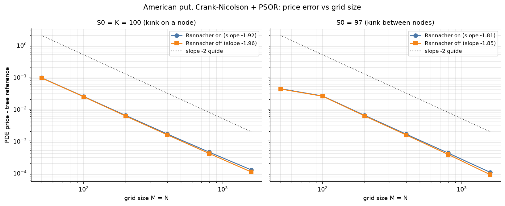

Figure A3. PDE price error vs M=N, Rannacher on and off. Model-only, same parameters, M=N=50..1600. Roughly second-order price convergence.

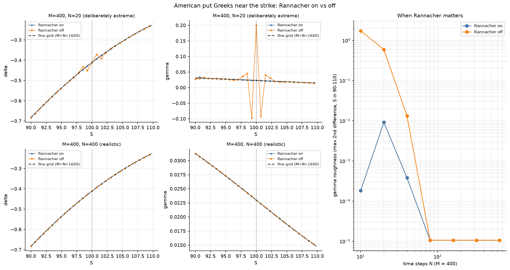

Figure A4. Gamma with and without Rannacher at M=400 and small N. Model-only. Smoothing matters only when N is small relative to M.

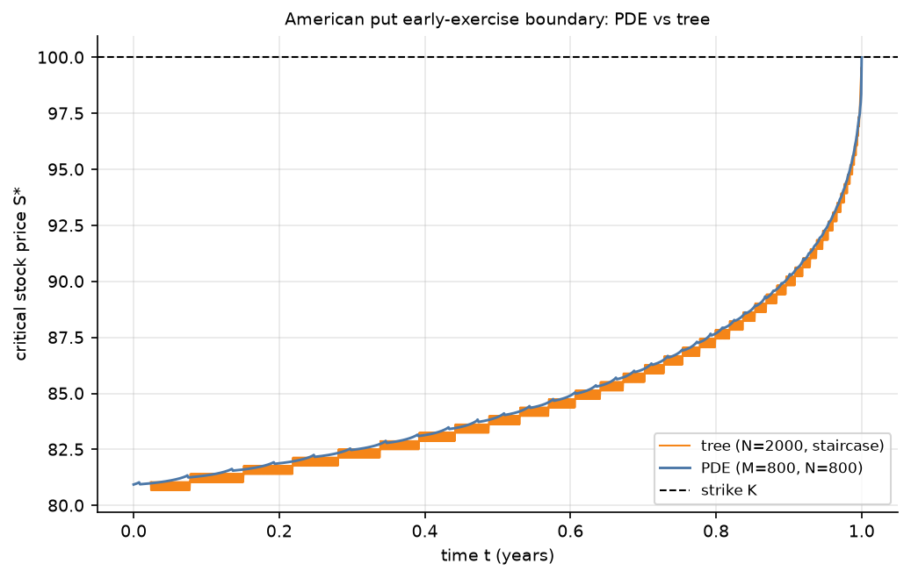

Figure A5. PDE boundary against the tree boundary. Model-only. Agreement within node spacing.

### Step 3: Bermudan benchmark and Longstaff-Schwartz

LSM prices a Bermudan option on `n_ex` equally spaced dates `T/n_ex, ..., T` (t = 0 excluded), so its right target is the Bermudan tree benchmark `tree_price(..., exercise_steps=bermudan_steps(N, n_ex))`, not the American price. The benchmark `bermudan_reference` averages adjacent multiples of `n_ex` and Richardson-extrapolates with the actual effective sizes; its error estimates are empirical. The Bermudan benchmark by `n_ex` is in the Results tables above.

LSM design. Exact GBM, `default_rng(seed)` for training and `default_rng([seed, 1])` for evaluation (independent streams; `eval_seed` selects one common evaluation set instead), optional antithetic pairs (standard errors on pair means). Regression on in-the-money paths only, `lstsq` on S/K inputs (not the normal equations); dates with too few in-the-money paths are skipped and their coefficients are NaN, so the policy never exercises there. Regressors: monomial, Chebyshev (the same polynomial span as monomial, checked in a test), exponentially weighted Laguerre (a re-weighted polynomial, not a distinct method), and an optional extra column holding the European option value at the remaining time (`european_basis=True`). Training memory is `8 * n_paths * (n_ex + degree + 11)` bytes, capped (`max_train_paths`); out-of-sample evaluation is chunked.

Two ways to evaluate a fitted policy. A *fresh* evaluation set per fit gives an unbiased level but its noise enters every comparison. A *common* evaluation set shared by all fits cancels that noise in differences between policies, but shifts every out-of-sample level by one shared offset of the size of that set's standard error. Levels and biases therefore come from fresh evaluation sets and policy comparisons from the common set. The LSM price table by training-path count and the bias decomposition are in the Results tables above.

Basis and degree (50,000 training paths, 20 seeds, `results/tables/lsm_basis_sweep.csv`). In-sample bias rises with degree because the exercise rule is fitted to the paths it is paid on. For policy quality the paired out-of-sample gain relative to Laguerre degree 3 shows that degrees 1-2 are clearly worse and that the plain polynomials are close from degree 3 up. The European value as an extra regressor lifts the low degrees (its rows at degrees 1-3) and the benefit fades at higher degrees:

<!-- table:lsm_basis -->
| basis | degree | in-sample bias | out-of-sample bias (fresh evaluation) | paired policy gain vs Laguerre degree 3 ± se |
|---|---|---|---|---|
| monomial | 1 | -0.0838 | -0.0978 | -0.0894 ± 0.0009 |
| monomial | 2 | -0.0089 | -0.0261 | -0.0146 ± 0.0006 |
| monomial | 3 | 0.0105 | -0.0113 | +0.0005 ± 0.0003 |
| monomial | 4 | 0.0149 | -0.0098 | +0.0016 ± 0.0004 |
| monomial | 5 | 0.0153 | -0.0086 | +0.0014 ± 0.0007 |
| monomial | 6 | 0.0193 | -0.0112 | +0.0002 ± 0.0008 |
| exp-weighted Laguerre | 1 | -0.0252 | -0.0399 | -0.0326 ± 0.0006 |
| exp-weighted Laguerre | 2 | -0.0109 | -0.0288 | -0.0172 ± 0.0005 |
| exp-weighted Laguerre | 3 | 0.0102 | -0.0116 | +0.0000 ± 0.0000 |
| exp-weighted Laguerre | 4 | 0.0141 | -0.0102 | +0.0021 ± 0.0005 |
| exp-weighted Laguerre | 5 | 0.0159 | -0.0092 | +0.0013 ± 0.0007 |
| exp-weighted Laguerre | 6 | 0.0182 | -0.0107 | +0.0007 ± 0.0008 |
| monomial + European value | 1 | 0.0092 | -0.0071 | +0.0050 ± 0.0005 |
| monomial + European value | 2 | 0.0161 | -0.0067 | +0.0042 ± 0.0003 |
| monomial + European value | 3 | 0.0152 | -0.0074 | +0.0028 ± 0.0004 |
| monomial + European value | 4 | 0.0178 | -0.0090 | +0.0017 ± 0.0008 |
| monomial + European value | 5 | 0.0181 | -0.0098 | +0.0007 ± 0.0008 |
| monomial + European value | 6 | 0.0194 | -0.0100 | -0.0004 ± 0.0009 |
<!-- /table:lsm_basis -->

Boundary. Comparing the 50-date Bermudan LSM policy with an *American* boundary mixes in the exercise-date discretization; adding the Bermudan tree boundary on the same dates removes most of the gap, so most of the apparent LSM boundary bias was date discretization, not LSM. The LSM boundary itself stays noisy and only the trend is tested.

<!-- table:boundary_gap -->
| comparison (0.3 < t < 0.9) | mean gap | mean abs gap |
|---|---|---|
| LSM - American PDE boundary | 1.280 | 1.280 |
| LSM - Bermudan tree boundary (same dates) | 0.112 | 0.384 |
<!-- /table:boundary_gap -->

The Bermudan/American boundary shift scales like σ sqrt(dt); the fitted constant is below the discrete-barrier constant 0.5826 (a heuristic borrowed from discretely monitored barrier options that holds only approximately here). I have no tested explanation for the smaller constant.

<!-- table:boundary_shift -->
| n_ex | measured Bermudan/American ratio | ratio predicted with 0.5826 | implied constant | share of predicted shift |
|---|---|---|---|---|
| 10 | 1.0332 | 1.0375 | 0.516 | 0.88 |
| 25 | 1.0203 | 1.0236 | 0.503 | 0.86 |
| 50 | 1.0147 | 1.0166 | 0.517 | 0.89 |
| 100 | 1.0094 | 1.0117 | 0.468 | 0.80 |
<!-- /table:boundary_shift -->

Statistical tests of the LSM prices (fixed seeds, criterion |z| < 4) are in `tests/test_lsm.py` with their measured z-scores in the comments; they are not reproduced here. Where early exercise has no value (call with q = 0, put with r = 0) the true policy never exercises, so any fitted rule can only lose value and the out-of-sample tests are one-sided with a stated bound on the shortfall.

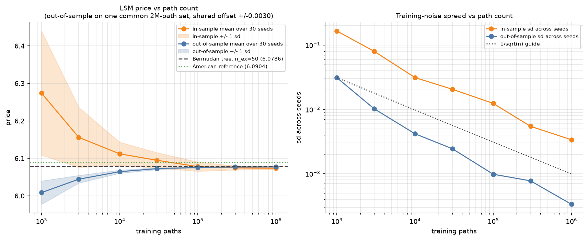

Figure A6. LSM in-sample vs out-of-sample price against training paths, 30 seeds, Bermudan benchmark. Model-only, n_ex=50, laguerre degree 3. In-sample bias high at small samples.

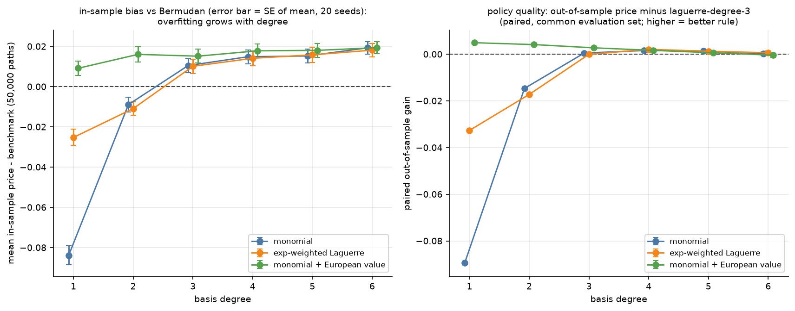

Figure A7. Basis and degree sweep, 50,000 training paths, 20 seeds. Model-only. A plateau from degree 3.

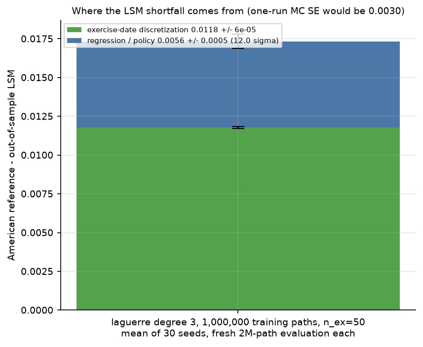

Figure A8. Bias decomposition into exercise-date discretization and regression/policy error. Model-only, 1,000,000 paths, 30 seeds. Both terms with error bars.

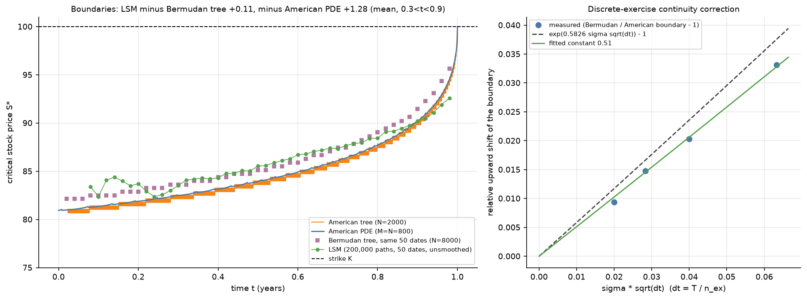

Figure A9. LSM boundary against the Bermudan tree boundary on the same 50 dates and the American PDE boundary. Model-only. Most of the apparent LSM boundary bias is date discretization.

Raw data for the error-vs-runtime comparison is in `results/tables/pareto_raw.csv` (tree, extrapolated tree, PDE PSOR and penalty, LSM in- and out-of-sample over 5 seeds, Laguerre degree 3). LSM errors there are against the *American* reference, so they include the exercise-date discretization term.

### Step 4: discrete cash dividends

`OptionParams.dividends = ((ex_time, amount), ...)` (sorted on creation, `0 < t < T`, `amount > 0`). The spot follows GBM with drift `r - q` between ex-dates and jumps `S -> max(S - D, 1e-8*K)` at each one (the floor only keeps log-grids and paths valid). Exercise is allowed at the ex-date cum-dividend, i.e. just before the drop. `dividends=()` reproduces every earlier price (checked against the Step 3 `pareto_raw.csv`).

- Tree (`tree.py`): plain CRR on S, no escrow. At the ex-date step the pre-dividend continuation at node `S_j` is the post-dividend layer linearly interpolated at `S_j - D`. Ex-dates snap to the nearest step with a `UserWarning` giving the time error; `aligned_steps(params, n_min)` returns an N that hits them exactly. Interpolation makes the tree first order in dt.
- PDE (`pde.py`): each ex-date is a forced step boundary through the `Event` hook; `V(S, t-) = V(S - D, t+)` by cubic spline in log-price, then `max(., payoff)`. Rannacher restarts after each event. The far-end Dirichlet asymptotes carry the present value of the remaining dividends.
- LSM (`lsm.py`): ex-dates must lie on the exercise grid (`ValueError` otherwise). The regression at an ex-date uses the cum-dividend price; the continuation cashflows are the post-drop path values.
- Reference: PDE at M=N=800/1600/3200 with Richardson at the observed order, cross-checked against aligned trees (`dividend_reference`); the gap between the two is the reference uncertainty (column "PDE vs tree gap" of the model-risk table above).
- Escrowed tree (`escrowed_price`): a different model, used only to size model risk (model-risk table above). The choice of dividend model moves the price by orders of magnitude more than the PDE-vs-tree gap.

Findings (as measured; `results/tables/dividend_*.csv`, `scripts/step4_dividends.py`):

- Merton, the empty put window and the boundary jump are measured in the Validation table (threshold 2.469 for these parameters; American call equals European below it; put window versus D/(rK); boundary jump across the ex-date). The put is never exercised cum-dividend because waiting past the ex-date gains D at the cost of interest `K r dt`, so the put exercise region is empty for `t_d - D/(rK) < t <= t_d`.
- Put premium vs D is non-monotonic. Hypothesis, written before the test: small dividends remove early-exercise value before the ex-date while the part after it grows with D. Test (tree N=4000, `dividend_put_premium_split.csv`, Figure A11): the premium with exercise allowed only up to the ex-date falls with D and the premium with exercise allowed only after it rises monotonically, and the total is essentially the after-ex-date premium for D of 2 and above. The hypothesis is supported.

<!-- table:put_split -->
| D | total put premium | exercise only up to the ex-date | exercise only after the ex-date |
|---|---|---|---|
| 0.00 | 0.5171 | 0.3635 | 0.4456 |
| 0.50 | 0.4867 | 0.2737 | 0.4656 |
| 1.00 | 0.4890 | 0.1916 | 0.4860 |
| 1.50 | 0.5070 | 0.1197 | 0.5069 |
| 2.00 | 0.5284 | 0.0617 | 0.5284 |
| 2.50 | 0.5504 | 0.0228 | 0.5504 |
| 3.00 | 0.5728 | 0.0050 | 0.5728 |
| 3.50 | 0.5958 | 0.0004 | 0.5958 |
| 4.00 | 0.6193 | 0.0000 | 0.6193 |
| 4.50 | 0.6433 | 0.0000 | 0.6433 |
| 5.00 | 0.6677 | 0.0000 | 0.6677 |
<!-- /table:put_split -->

- Discrete dividend vs the equivalent continuous yield (D=3, `q` matches the forward):

<!-- table:discrete_cont -->
| model | American put | European put | premium | yield q |
|---|---|---|---|---|
| discrete | 7.4072 | 6.8347 | 0.5725 | 0.0000 |
| continuous | 6.9630 | 6.7184 | 0.2446 | 0.0297 |
| none | 6.0902 | 5.5734 | 0.5168 | 0.0000 |
<!-- /table:discrete_cont -->

  The difference between the discrete and continuous-yield American put peaks near the no-dividend boundary (`step4_discrete_vs_continuous.png`, Figure A13). With D=3 the empty window D/(rK) is longer than the time to the ex-date, so a put at today's no-dividend boundary cannot exercise before the ex-date, whereas under a continuous yield it can.
- LSM on the large-dividend call is a limitation, not something tuned away. The exercise region exists at a single date, which a smooth low-degree polynomial cannot represent, so about half of all early exercises happen at the wrong dates at degree 3. Higher degree and the European-value regressor are shown as diagnostics only; the headline LSM numbers were not tuned with them:

<!-- table:dividend_lsm -->
| basis | degree | mean out-of-sample minus Bermudan | sd across seeds | share of early exercises off the ex-date |
|---|---|---|---|---|
| laguerre | 3 | -0.0285 | 0.0045 | 0.49 |
| monomial | 3 | -0.0340 | 0.0023 | 0.51 |
| monomial | 5 | -0.0025 | 0.0014 | 0.05 |
| monomial + European value | 3 | -0.0129 | 0.0026 | 0.30 |
<!-- /table:dividend_lsm -->

#### Step 4 figures

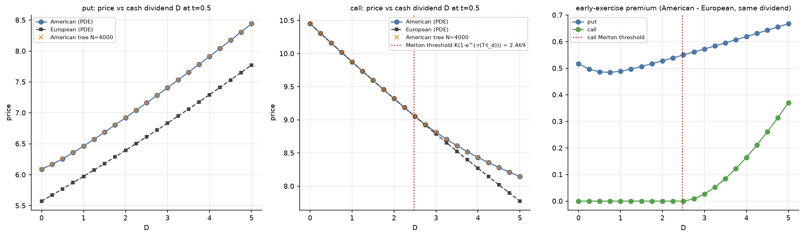

Figure A10. Early-exercise premium against dividend size D. Model-only: S=K=100, T=1, r=5%, t_d=0.5. Call premium zero below the Merton threshold; the put premium is non-monotonic.

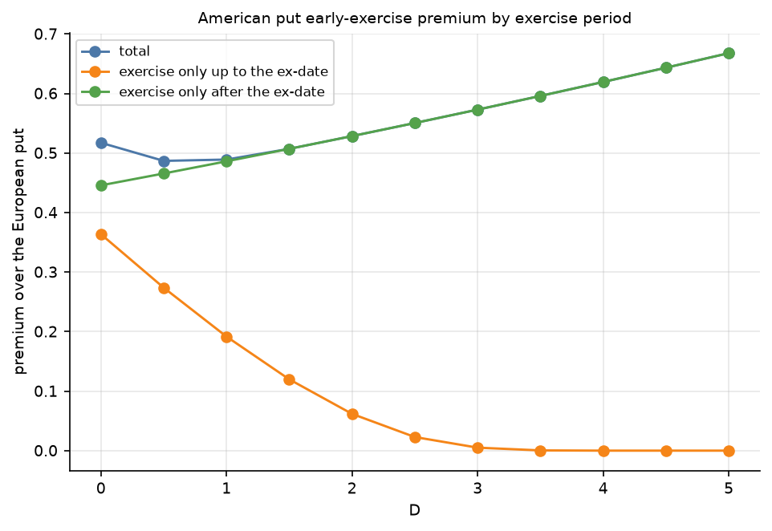

Figure A11. Put premium with exercise allowed only before, or only after, the ex-date. Model-only, tree N=4000. The two parts move in opposite directions.

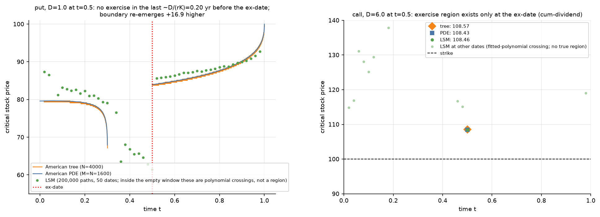

Figure A12. Exercise boundaries with a dividend (put D=1, call D=6). Model-only. The empty window and the jump across the ex-date.

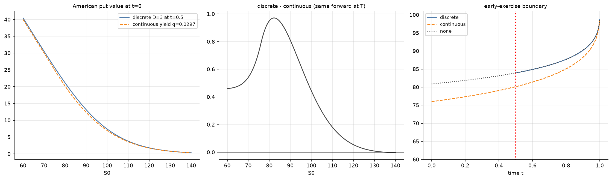

Figure A13. Discrete dividend vs the equivalent continuous yield (D=3). Model-only. The price difference peaks near the no-dividend boundary.